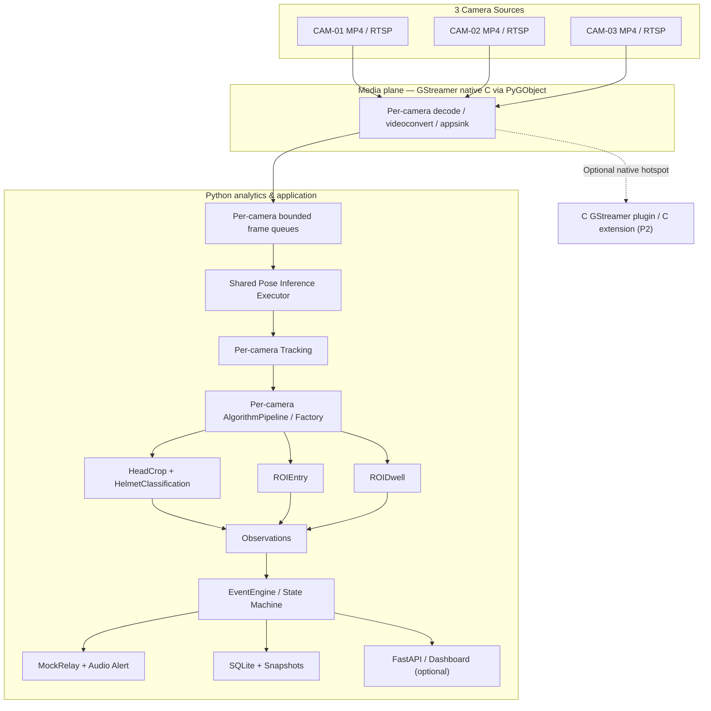
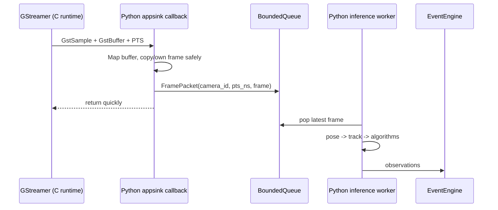

# IMPLEMENTATION PLAN — INDUSTRIAL SAFETY MONITORING SYSTEM (ISMS)

**Loại tài liệu:** Kế hoạch triển khai source code theo module/file (chưa phải code hoàn thiện)  
**Phiên bản:** 1.1 — Python + C  
**Cập nhật:** 22/11/2026  
**Deadline bài test:** Trước ngày 24/11/2026  
**Thiết kế:** GStreamer → Pose Estimation → Tracking → Algorithms (Helmet / ROI Entry / ROI Dwell) → Event Engine → Alert / SQLite.

> **Quyết định công nghệ:** **Python là ngôn ngữ chính** cho ứng dụng, inference, OOP algorithms, event engine, API và test. **GStreamer là thư viện native viết bằng C**, được điều khiển trực tiếp từ Python thông qua **PyGObject (`gi.repository.Gst`)**. Chỉ viết **module/plugin C riêng khi có nhu cầu tối ưu đo được** (zero-copy, xử lý GstBuffer, plugin native). **Không sử dụng C++ làm ngôn ngữ chính, không yêu cầu `CMakeLists.txt`/`.hpp`/`.cpp` để chạy MVP.**

**Giả định MVP:** Chạy 3 MP4 mô phỏng 3 CCTV trên một máy; phần cứng relay giả lập. Có thể chuyển đầu vào thành RTSP. Edge phân tán là phương án triển khai production, **không phải chức năng P0 bắt buộc**.

---

## 1. Phạm vi, ưu tiên và tiêu chí hoàn thành

| Camera | Pipeline | Event |
|---|---|---|
| CAM-01 | Pose → Track → Head Crop → Helmet Classifier + ROI | `NO_HELMET`, `ROI_ENTER`, tùy chọn `ROI_DWELL` |
| CAM-02 | Pose → Track → ROI | `ROI_ENTER`, tùy chọn `ROI_DWELL` |
| CAM-03 | Pose → Track → Head Crop → Helmet Classifier | `NO_HELMET` |

### P0 — Phải hoạt động để quay demo

- [ ] Một lệnh Python chạy ba video, mỗi camera có rule/ROI trong YAML.
- [ ] Pose trả person bbox và keypoints đúng hệ tọa độ; tracker quản lý track ID riêng từng camera.
- [ ] Crop đầu từ pose, classification `HELMET` / `NO_HELMET` / `UNKNOWN` theo từng người.
- [ ] `ROI_ENTER` phát khi chuyển trạng thái ngoài → trong, không phát ở mọi frame.
- [ ] Mock relay bật theo intrusion và tắt hợp lý khi không còn vi phạm active.
- [ ] Event engine chống trùng, lưu SQLite + snapshot; in event ở console hoặc hiển thị UI.
- [ ] Có video demo và README tái lập được.

### P1 — Nếu còn thời gian

- [ ] `ROI_DWELL` theo timestamp (không tính số frame), xác nhận một lần mỗi lượt.
- [ ] API FastAPI, lịch sử events, MJPEG/WebSocket, UI đơn giản.
- [ ] Metrics: per-camera FPS, thời gian inference, latency, dropped frames và failure cases.

### P2 — Hướng mở rộng, không chặn nộp

- [ ] MQTT Edge → Server với local retry queue, edge health, reconnect RTSP đầy đủ.
- [ ] C plugin cho GStreamer hoặc C extension tối ưu vùng xử lý tốn CPU theo profiling.
- [ ] TensorRT/ONNX Runtime tối ưu GPU, C-ABI integration nếu hiệu năng đòi hỏi.

**Không cam kết production-ready / safety-certified.** Khi không nhìn rõ đầu, kết quả phải là `UNKNOWN`, không coi là `NO_HELMET`.

---

## 2. Kiến trúc Python + native C/GStreamer



### Phân chia trách nhiệm

| Tầng | Công nghệ | Nhiệm vụ |
|---|---|---|
| Media | GStreamer (native C) + PyGObject Python binding | Đọc MP4/RTSP, decode, convert, timestamp, optional encode/output |
| Inference | Python + PyTorch hoặc ONNX Runtime (Python API) | Pose model và helmet classifier |
| Algorithm | Python ABC + dataclasses + NumPy/OpenCV | Helmet compliance, ROI Entry, ROI Dwell |
| Event | Python | Stateful violations, debounce, deduplication, local relay |
| Storage/API | Python: SQLite, FastAPI (nếu làm) | Persist, replay, query, WebSocket |
| Native acceleration (chỉ khi cần) | C11 + GLib/GStreamer C API, hoặc C extension | Bước xử lý nặng đo được; không thay toàn bộ Python |

**Ghi chú C/Python:** Dùng PyGObject **không đồng nghĩa với việc bạn phải viết C**. GStreamer được hiện thực bằng C, còn orchestration gọi qua binding Python. Nếu mục tiêu bài test bắt buộc có *source code C do bạn tự viết*, có thể thêm một C plugin nhỏ sau khi MVP hoàn chỉnh; cần ghi rõ trong tài liệu phần nào dùng native library sẵn có và phần nào tự triển khai.

### Quy tắc runtime

1. Không chạy neural network, SQLite hoặc HTTP ngay trong callback `appsink`; callback chỉ nhận sample, lấy PTS và copy/retain frame an toàn rồi đẩy queue.
2. Inference model được load một lần và chia sẻ qua `InferenceExecutor`; có scheduling giữa 3 camera để tránh cùng tranh GPU không kiểm soát.
3. Tracking và algorithm chứa state phải là **instance riêng mỗi camera**; không dùng chung map `track_id`.
4. Bounded queue per camera; khi quá tải có chính sách bỏ frame cũ có đo đếm để giảm latency, không tăng RAM vô hạn.
5. `frame_id`, `pts_ns`, `camera_id`, `received_at_monotonic_ns`, `received_at_utc` cần nhất quán xuyên các tầng.
6. Cần tách **thời gian trong video (PTS)** để tính ROI dwell khi chạy file demo và **wall-clock/monotonic time** để đo độ trễ cảnh báo trong thực tế.

---

## 3. Cấu trúc source code theo file

```text
industrial-safety-monitor/
├── pyproject.toml                    # package, dependencies, pytest/ruff
├── README.md
├── .env.example
├── configs/
│   ├── cameras.yaml                 # source, ROI, rules từng camera
│   └── models.yaml                  # weights, thresholds, device
├── models/                           # không commit weight quá lớn
├── assets/sample_videos/             # video demo được phép sử dụng
├── src/isms/
│   ├── __init__.py
│   ├── main.py                      # CLI/app entry point
│   ├── config/
│   │   ├── schema.py                # Pydantic config schema
│   │   └── loader.py                # parse/validate YAML
│   ├── core/
│   │   ├── types.py                 # dataclass + Enum chung
│   │   ├── frame_context.py         # FramePacket / FrameContext
│   │   └── frame_queue.py           # bounded queue / drop policy
│   ├── media/
│   │   ├── gst_runtime.py           # Gst.init + GLib main loop
│   │   ├── gst_camera.py            # per-camera GStreamer appsink
│   │   ├── source_factory.py        # MP4 vs RTSP pipeline creation
│   │   └── video_output.py          # optional overlay/record output
│   ├── inference/
│   │   ├── base.py                  # IPoseEstimator, IHelmetClassifier
│   │   ├── pose_estimator.py        # Python PyTorch/ONNX pose adapter
│   │   ├── helmet_classifier.py     # classify / batch crops
│   │   ├── head_crop.py             # pose -> valid head ROI
│   │   └── executor.py              # shared GPU inference scheduler
│   ├── tracking/
│   │   └── person_tracker.py        # ByteTrack adapter / per-camera
│   ├── algorithms/
│   │   ├── base.py                  # Algorithm ABC
│   │   ├── helmet_compliance.py     # person -> PPE observation
│   │   ├── roi_entry.py             # outside->inside / exit
│   │   ├── roi_dwell.py             # elapsed time in ROI
│   │   ├── factory.py               # YAML -> Algorithm instance
│   │   └── pipeline.py              # per-camera dispatcher
│   ├── events/
│   │   ├── models.py                # Observation, Event, EventStatus
│   │   ├── engine.py                # NORMAL/PENDING/ACTIVE/RESOLVED
│   │   └── dispatcher.py            # outputs fanout / idempotency
│   ├── outputs/
│   │   ├── relay.py                 # RelayController Protocol
│   │   ├── mock_relay.py            # bật/tắt relay giả lập
│   │   └── snapshot.py              # snapshot save
│   ├── storage/
│   │   ├── database.py              # SQLite lifecycle
│   │   └── event_repository.py      # insert/update/query
│   ├── app/
│   │   ├── camera_runtime.py        # camera lifecycle + tracking + rules
│   │   └── camera_manager.py        # start/stop 3 cameras
│   └── api/                          # P1
│       ├── main.py                  # FastAPI
│       └── websocket.py
├── native/                           # P2 ONLY: C code do mình viết
│   ├── meson.build                   # build shared lib/GStreamer plugin
│   ├── include/
│   │   └── safety_buffer.h           # nếu có C ABI / plugin header
│   ├── src/
│   │   └── gst_safety_meta.c         # optional native GstMeta plugin
│   └── README.md                    # rationale, benchmark, cách build
├── tests/
│   ├── test_head_crop.py
│   ├── test_roi_entry.py
│   ├── test_roi_dwell.py
│   ├── test_helmet_unknown.py
│   ├── test_event_engine.py
│   ├── test_relay_multiple_tracks.py
│   └── test_config_per_camera.py
├── scripts/
│   ├── export_models.py
│   ├── benchmark.py
│   └── run_demo.sh
├── docs/
│   └── diagrams/
└── docker-compose.yml                # P2; hoặc optional API demo
```

**Phân biệt bắt buộc:** `native/` là nơi chứa **code C tự viết** nếu sau này cần; **P0 không phụ thuộc vào nó**. Không dùng `ctypes`/`cffi` để gọi GStreamer nếu PyGObject đã có API phù hợp — tránh tăng độ phức tạp ABI, ownership và memory safety không cần thiết.

### File-by-file: đầu vào / đầu ra / tiêu chí

| File | Trách nhiệm | Test / acceptance |
|---|---|---|
| `media/gst_camera.py` | `Gst.Pipeline`, `GstAppSink`, PTS, frame conversion | Frame BGR đúng kích thước, không block |
| `core/frame_queue.py` | Bounded frame queue, latest-frame strategy | Full queue có dropped counter |
| `inference/pose_estimator.py` | Inference bbox + COCO-like keypoints | Output frame-native coords |
| `tracking/person_tracker.py` | Stable track IDs riêng stream | ID không xung đột giữa camera |
| `inference/head_crop.py` | Head bbox + padding, invalid reason | Crop mũ không bị cắt, `UNKNOWN` khi thiếu |
| `inference/helmet_classifier.py` | Predict batch/head status | Không suy diễn no-helmet khi score thấp |
| `algorithms/helmet_compliance.py` | Cache/smoothing theo track ID | Không spam `NO_HELMET` |
| `algorithms/roi_entry.py` | `ROI_ENTER/EXIT`, hysteresis | Chỉ một enter/exit cho mỗi lượt |
| `algorithms/roi_dwell.py` | Dwell từ timestamp | Một event khi vượt threshold |
| `events/engine.py` | State machine event | Lifecycle đúng, dedup đúng |
| `outputs/mock_relay.py` | Bật/tắt theo số intrusion active | 2 người trong ROI, 1 người ra không OFF |
| `storage/event_repository.py` | Persist/update event | Lịch sử còn sau restart |
| `app/camera_manager.py` | Quản lý 3 camera | Camera lỗi không dừng cả app |
| `native/src/*.c` (P2) | Native Gst buffer processing/metadata | Benchmark + unit/integration test ABI |

---

## 4. Python interface contract (OOP)

### 4.1. Model/data schema

```python
from dataclasses import dataclass
from enum import Enum
from typing import Protocol
import numpy as np

class HelmetStatus(str, Enum):
    HELMET = "HELMET"
    NO_HELMET = "NO_HELMET"
    UNKNOWN = "UNKNOWN"

@dataclass(frozen=True)
class Keypoint:
    x: float
    y: float
    confidence: float

@dataclass(frozen=True)
class BoundingBox:
    x1: float
    y1: float
    x2: float
    y2: float
    confidence: float

@dataclass(frozen=True)
class PersonTrack:
    track_id: int
    bbox: BoundingBox
    keypoints: tuple[Keypoint, ...]

@dataclass(frozen=True)
class FrameContext:
    camera_id: str
    frame_id: int
    pts_ns: int
    frame_bgr: np.ndarray    # read-only by convention
    persons: tuple[PersonTrack, ...]

class PoseEstimator(Protocol):
    def infer(self, frame_bgr: np.ndarray) -> list: ...

class HelmetClassifier(Protocol):
    def infer_batch(self, crops: list[np.ndarray]) -> list: ...
```

### 4.2. Algorithm base class và factory

```python
from abc import ABC, abstractmethod

class Algorithm(ABC):
    @property
    @abstractmethod
    def name(self) -> str: ...

    @abstractmethod
    def process(self, context: FrameContext) -> list["Observation"]: ...

    def reset(self) -> None:
        pass

class HelmetComplianceAlgorithm(Algorithm):
    def __init__(self, extractor, classifier, settings):
        self.extractor = extractor
        self.classifier = classifier
        self.settings = settings
        self.track_states = {}

    @property
    def name(self) -> str:
        return "helmet_compliance"

    def process(self, context: FrameContext) -> list["Observation"]:
        # head crops -> batch classify -> per-track temporal validation
        raise NotImplementedError

class AlgorithmPipeline:
    def __init__(self, algorithms: list[Algorithm]):
        self.algorithms = algorithms

    def process(self, context: FrameContext) -> list["Observation"]:
        observations = []
        for algorithm in self.algorithms:
            observations.extend(algorithm.process(context))
        return observations
```

**Đây là interface/skeleton cho kế hoạch, không phải implementation hoàn chỉnh.** `AlgorithmFactory` map cấu hình YAML sang constructor; `HelmetComplianceAlgorithm` phụ thuộc classifier được **inject**, `ROI*` không cần biết neural model. `AlgorithmPipeline` riêng cho từng camera.

**Không dùng chung một base class cho PoseEstimator và ROI algorithms**: model trả kết quả AI; algorithm tạo business observations. Dùng composition thay vì kế thừa sâu.

---

## 5. Thiết kế algorithms

### 5.1. Pose + tracking

- Chọn model pose có bbox và keypoints; xác nhận keypoint layout (ví dụ COCO-17) trước khi crop.
- Đưa keypoint về tọa độ frame gốc; tính đến letterbox, resize và padding.
- Tracking chạy trên detection mỗi frame / frame sampled, tracker **riêng cho từng camera**.
- Lưu track age, last_seen và camera_id; quản lý khi detector bỏ sót ngắn hạn.

### 5.2. Pose → head crop → helmet classifier

1. Lấy keypoints mũi/mắt/tai có confidence đạt ngưỡng.
2. Ước lượng ROI vùng đầu có padding phía trên để bao phủ phần mũ; clamp trong frame.
3. Nếu keypoints thiếu, crop quá nhỏ hoặc ảnh quá mờ: `UNKNOWN`. Có thể fallback top portion của person bbox nhưng phải đánh dấu confidence/risk riêng.
4. Batch các crop hợp lệ và chạy `HelmetClassifier.infer_batch()`.
5. Gắn kết quả về đúng `(camera_id, track_id)`; smoothing N frame/cửa sổ thời gian; cache TTL để giảm inference dư.
6. Chỉ tạo observation `NO_HELMET` khi đủ bằng chứng, không dùng absence-of-helmet như chứng cứ nếu crop không hợp lệ.

**Ablation nếu có thời gian:** so sánh pose-based crop với bbox-top crop về F1, UNKNOWN rate, độ trễ.

### 5.3. ROI Entry

- Polygon tọa độ chuẩn hóa `[0..1]`, chuyển ra pixel theo frame gốc.
- Ưu tiên foot point từ bbox `(x1+x2)/2, y2`; có thể cân nhắc ankle keypoints nếu camera cho phép.
- `cv2.pointPolygonTest()` với hysteresis để chống rung ở biên.
- Trạng thái ban đầu `UNSEEN/OUTSIDE/INSIDE`; chỉ phát `ROI_ENTER` sau chuyển đổi có xác nhận.
- Người đã đứng trong ROI ngay frame đầu: không tự coi là đã **đi vào**; có thể phát `ROI_OCCUPIED` là event riêng nếu muốn báo nguy hiểm ngay.

### 5.4. ROI Dwell

- Lưu `entered_pts_ns` theo `(camera_id, roi_id, track_id)`.
- `duration_ms = (current_pts_ns - entered_pts_ns) / 1e6`; chú ý seek/loop MP4 phải reset tracker và state khi PTS reset.
- Một lượt trong ROI → tối đa 1 `ROI_DWELL`; khi ra khỏi ROI có xác nhận mới reset.
- Dwell là mở rộng khả năng, **không thay thế cảnh báo intrusion lập tức**.

### 5.5. Event engine và relay

- State per `(camera_id, rule_id, track_id, event_type)`: `NORMAL → PENDING → ACTIVE → RESOLVED`.
- `ROI_ENTER` mở một intrusion session; `ROI_EXIT` (hoặc timeout có chính sách rõ) kết thúc session.
- Relay ON khi `active_intrusions(camera_id) > 0`; chỉ OFF khi không còn người/vi phạm active theo policy.
- `NO_HELMET` có event/alert riêng; theo đề không cần relay cho PPE.
- Event UUID idempotent, SQLite có UNIQUE; không ghi một record trên mỗi frame.
- Khi mất camera/network không tự kết luận khu vực an toàn; báo `CAMERA_OFFLINE` và nêu relay failure policy.

---

## 6. GStreamer: tích hợp chính xác bằng Python

### 6.1. Stack tối thiểu

- Ubuntu/WSL + GStreamer 1.x cùng các plugin decode cần thiết.
- `python3-gi`, `gir1.2-gstreamer-1.0`, `gir1.2-gst-plugins-base-1.0` (tùy distro). Runtime có thể cần cài vào environment đang dùng; không mặc định `pip install pygobject` luôn là con đường dễ nhất.
- Python: `import gi; gi.require_version("Gst", "1.0"); from gi.repository import Gst, GLib`.
- ML: PyTorch hoặc ONNX Runtime Python API; NumPy/OpenCV cho crop và polygon.

### 6.2. Pipeline MVP theo nguồn

```text
MP4/file: uridecodebin uri=file:///... -> videoconvert -> video/x-raw,format=BGR -> appsink
RTSP:     rtspsrc -> depay -> parse -> decode -> videoconvert -> video/x-raw,format=BGR -> appsink
```

**Kết nối `uridecodebin`/`rtspsrc` thường dùng dynamic pad; code Python phải xử lý pad-added/caps và linking đúng.** Khi cần demo nhanh có thể dùng `Gst.parse_launch()` với pipeline phù hợp video thực tế; không coi hai dòng trên là câu lệnh GStreamer hoàn chỉnh dùng cho mọi codec.

### 6.3. appsink worker boundary



**Quan trọng:** Không giữ NumPy view tham chiếu vùng nhớ `GstBuffer` sau khi unmap/release sample; copy hoặc giữ ownership đúng. Phải xử lý stride/pixel format/caps, không mặc định mọi buffer BGR contiguous. Không dùng `GLib.MainLoop` để thực thi blocking inference. Có thể dùng GLib main loop riêng và Python worker thread/process; với GPU model cần một inference scheduler để tránh race/overload.

### 6.4. Có nên tự viết C plugin?

**Không ở P0.** `Gst` đã dùng implementation C native qua binding Python. Chỉ chuyển hotspot sang C nếu benchmark xác định Python callback/CPU conversion là bottleneck:

- `native/src/gst_safety_meta.c`: plugin/GstMeta phục vụ data path native sau khi cần metadata/zero-copy.
- `native/meson.build`: build một shared object/plugin C; phụ thuộc `gstreamer-1.0`, `glib-2.0`.
- Giao tiếp Python ↔ native C qua GStreamer object/metadata API; tránh tự chế pointer lifetime/FFI nếu không cần.
- Khi viết C plugin: kiểm tra thread-safety, GObject refcount, buffer map/unmap, ABI/plugin discovery; đo so sánh trước/sau.

**Không nên đưa helmet classifier vào một C plugin chỉ để có code C**: nó làm khó việc quản lý model, test và đổi backend mà không tạo lợi ích rõ ràng cho bài test.

### 6.5. Output và encode

- P0: overlay bằng OpenCV để quay demo, hoặc preview Python; không block decoder.
- P1: `appsrc ! videoconvert ! encoder ! mux ! filesink` hoặc WebSocket/MJPEG; cần caps, PTS/duration và encode queue phù hợp.
- P2: split `tee` cho nhánh original output và analytics, đồng bộ kết quả theo PTS/Frame ID.

---

## 7. Cấu hình mẫu

```yaml
runtime:
  inference_backend: onnxruntime_python
  device: cuda  # fallback CPU nếu không có CUDA
  max_frame_queue: 3
  enable_mock_relay: true

models:
  pose: models/pose.onnx
  helmet_classifier: models/helmet_classifier.onnx

cameras:
  - id: cam_01
    source: assets/sample_videos/cam1.mp4
    algorithms:
      - {type: helmet_compliance, confidence_threshold: 0.80}
      - {type: roi_entry, roi_id: danger_a}
      - {type: roi_dwell, roi_id: danger_a, threshold_ms: 5000}
    rois:
      danger_a: [[0.10, 0.35], [0.90, 0.35], [0.90, 0.95], [0.10, 0.95]]

  - id: cam_02
    source: assets/sample_videos/cam2.mp4
    algorithms:
      - {type: roi_entry, roi_id: danger_b}
    rois:
      danger_b: [[0.10, 0.40], [0.90, 0.40], [0.90, 0.95], [0.10, 0.95]]

  - id: cam_03
    source: assets/sample_videos/cam3.mp4
    algorithms:
      - {type: helmet_compliance, confidence_threshold: 0.80}
```

*Các tọa độ ROI và threshold chỉ là ví dụ, chưa qua thực nghiệm. Weights/model phải do người triển khai chuẩn bị và kiểm tra license, nhãn và preprocessing.*

---

## 8. Event schema / SQLite

```json
{
  "event_id": "uuid",
  "camera_id": "cam_01",
  "track_id": 12,
  "rule_id": "danger_a",
  "event_type": "ROI_ENTER",
  "severity": "CRITICAL",
  "status": "ACTIVE",
  "started_at_utc": "2026-11-23T09:00:00Z",
  "ended_at_utc": null,
  "snapshot_path": "snapshots/uuid.jpg",
  "metadata": {"head_status": "UNKNOWN", "frame_id": 143}
}
```

SQLite: `events(id PRIMARY KEY, camera_id, track_id, rule_id, type, severity, status, started_at_utc, ended_at_utc, snapshot_path, metadata_json)`. Index `(camera_id, started_at_utc)`; event lifecycle cập nhật cùng record. Ảnh/video camera được lưu nội bộ trong MVP, không gửi bên thứ ba.

---

## 9. Task backlog file-by-file

| Task | Priority | File/nhóm file | Acceptance |
|---|---|---|---|
| T01 | P0 | `pyproject.toml`, `src/isms/main.py`, `config/*` | CLI load camera/model YAML |
| T02 | P0 | `media/gst_runtime.py`, `media/gst_camera.py`, `core/frame_queue.py` | Đọc MP4 + PTS, không block |
| T03 | P0 | `inference/pose_estimator.py` | Bbox/keypoints, normalize back to frame |
| T04 | P0 | `tracking/person_tracker.py` | `track_id` per camera |
| T05 | P0 | `inference/head_crop.py` | Head ROI/debug crops/invalid cases |
| T06 | P0 | `inference/helmet_classifier.py` | Batch crop → helmet/no-helmet/unknown |
| T07 | P0 | `algorithms/base.py`, `factory.py`, `pipeline.py` | Camera config → modules riêng |
| T08 | P0 | `algorithms/roi_entry.py` | 1 enter/exit mỗi lượt |
| T09 | P1 | `algorithms/roi_dwell.py` | 1 dwell đúng threshold |
| T10 | P0 | `algorithms/helmet_compliance.py` | Per-track classification, smoothing |
| T11 | P0 | `events/engine.py`, `outputs/mock_relay.py` | Dedup, relay ON/OFF đúng |
| T12 | P0 | `storage/event_repository.py`, `outputs/snapshot.py` | SQLite + ảnh event |
| T13 | P0 | `app/camera_runtime.py`, `app/camera_manager.py` | 3 camera hoạt động từ 1 lệnh |
| T14 | P0 | `tests/test_*.py`, demo script | Test state logic + video demo |
| T15 | P1 | `api/main.py`, `api/websocket.py` | UI/API xem lịch sử và alert |
| T16 | P1 | `scripts/benchmark.py` | FPS/latency CPU/GPU measurements |
| T17 | P2 | MQTT client + offline queue | Retry/event idempotency |
| T18 | P2 | `native/*.c`, `native/meson.build` | Chỉ làm nếu profiling có bottleneck |

**Thứ tự tích hợp nên làm:**

1. **Vertical slice A:** MP4 → pose → crop đầu → classifier → console result.
2. **Vertical slice B:** Thêm tracker + polygon ROI + `ROI_ENTER` + relay mock.
3. **Vertical slice C:** Event engine + SQLite/snapshot.
4. **Vertical slice D:** Ba nguồn video, rule per-camera, log dropped frames và kiểm tra chịu tải.
5. **Polish:** ROI dwell, preview/dashboard, benchmark, documentation. Native C tùy chọn.

---

## 10. Unit / integration test plan

| Test | Dữ liệu | Kỳ vọng |
|---|---|---|
| TS-01 | 1 người outside → inside | Một `ROI_ENTER`, relay ON |
| TS-02 | 1 người ở trong ROI > 5s | Một `ROI_DWELL` nếu bật |
| TS-03 | 2 người inside, 1 rời | Relay vẫn ON |
| TS-04 | Crop head không thấy rõ / too small | `UNKNOWN`, không `NO_HELMET` |
| TS-05 | Helmet/người không mũ đứng sát nhau | Classification gắn đúng track |
| TS-06 | ROI boundary jitter | Không spam enter/exit |
| TS-07 | Camera mất nguồn / queue đầy | Camera khác chạy, có metric/drop log |
| TS-08 | Mất track/reappear | Timeout theo chính sách, không lặp event bất hợp lý |
| TS-09 | MP4 loop/PTS reset | Dwell/tracker reset đúng |
| TS-10 | Restart process | SQLite còn event, ID không trùng |

Đo thêm: `pose_ms`, `helmet_ms`, `queue_wait_ms`, `alert_latency_ms`, `fps_per_camera`, `dropped_frames`, `gpu_memory`. Benchmark bắt buộc ghi thiết bị đo, video nguồn, số stream, input resolution.

---

## 11. Kế hoạch triển khai theo thứ tự và thời gian còn lại

**Ngày 22/11:** Ưu tiên hoàn thành pipeline một camera và module P0 (pose → crop/classify, ROI), test bằng MP4.  
**Ngày 23/11:** Ghép ba camera, event/SQLite/relay; quay demo, viết sơ đồ và tài liệu, ghi benchmark nếu làm được.  
**Trước 24/11:** Gửi source, video và tài liệu. Không chờ custom C plugin/Edge thật để nộp.

**Rủi ro hàng đầu:** (1) head crop pose không đủ chất lượng, (2) GStreamer buffer pixel format/stride, (3) classifier quá chậm khi nhiều người, (4) ROI state sai khi mất track, (5) over-engineering native C trước demo.

### Lệnh chạy mong muốn

```bash
python -m isms.main --config configs/cameras.yaml
# hoặc
./scripts/run_demo.sh

pytest -q
```

**Deliverables:** Source Python + config + readme, video demo ba camera, event snapshots, log/SQLite, Technical Solution Design theo `DOCUMENTATION_PLAN.md`. Nếu đã viết C module, nộp thêm build instructions và benchmark; nếu chưa, ghi chính xác sử dụng GStreamer native C thông qua PyGObject.

**Kiến trúc chốt:** **Python-first Modular Video Analytics, GStreamer native C via Python bindings, optional handwritten C hotpath.**
