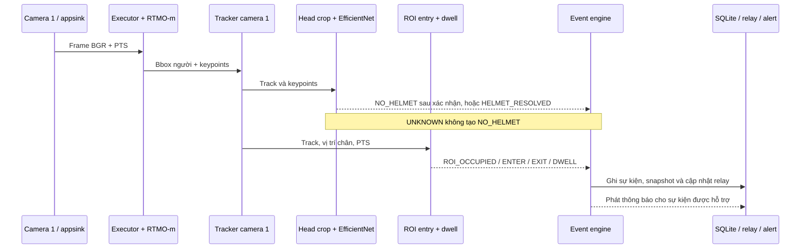
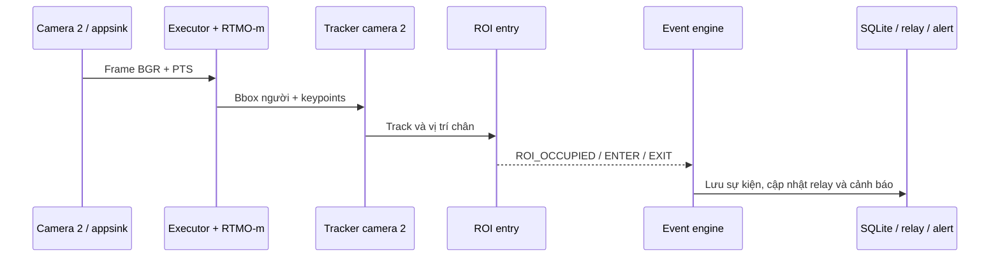
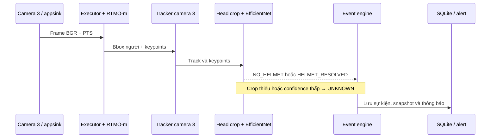
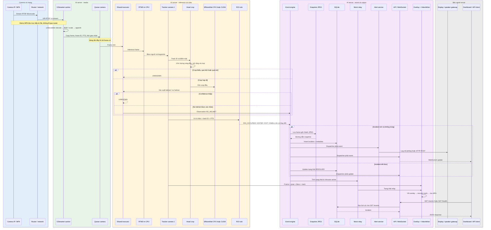

# Sequence thuật toán cho từng camera

Mỗi sequence là một nhánh logic, các camera có thể chạy đồng thời và chia sẻ executor. Tracker và rule có state riêng theo camera.

## Camera 1 — mũ bảo hộ và ROI

## Camera 2 — ROI

## Camera 3 — mũ bảo hộ

ROI ở camera 2 không bật dwell. Camera 3 không cấu hình ROI. Xem `configs/cameras.yaml` để thay đổi rule.

## Sequence đầy đủ từ RTSP đến event và thiết bị

Ví dụ dưới đây dùng camera 1. Camera 2 bỏ nhánh phân loại mũ; camera 3 bỏ nhánh ROI. Các `box` thể hiện vị trí triển khai. RTSP và thiết bị HTTP cần được cấu hình và kiểm chứng trong môi trường thực.

