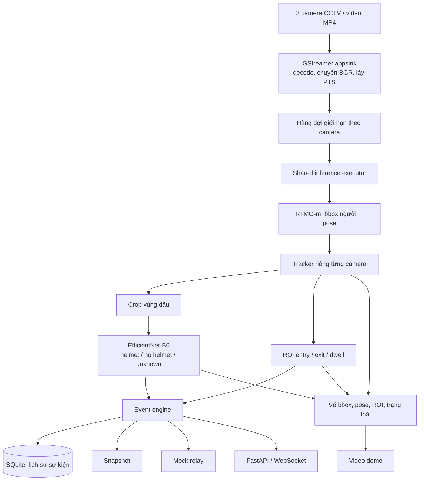

# BÁO CÁO BÀI TEST KỸ THUẬT

## Hệ thống giám sát an toàn nhà máy bằng AI và thị giác máy tính

**Vị trí:** AI/Computer Vision Engineer  
**Ứng viên:** Toản  
**Ngày:** 23/11/2026

## 1. Bài toán và phạm vi

Mục tiêu là xây dựng hệ thống giám sát ba camera tại các khu vực khác nhau của nhà máy, phát hiện người đi vào khu vực nguy hiểm và/hoặc không đội mũ bảo hộ. Khi có sự kiện, hệ thống lưu lịch sử, hiển thị cảnh báo và mô phỏng tín hiệu điều khiển thiết bị.

| Nguồn | Chức năng cấu hình | Kết quả cần tạo |
|---|---|---|
| Camera 1 | Pose và tracking, kiểm tra mũ, xâm nhập ROI, thời gian ở trong ROI | `NO_HELMET`, `ROI_ENTER`, `ROI_OCCUPIED`, `ROI_DWELL` |
| Camera 2 | Pose và tracking, xâm nhập ROI | `ROI_ENTER`, `ROI_OCCUPIED` |
| Camera 3 | Pose và tracking, kiểm tra mũ | `NO_HELMET` |

Hệ thống được xây dựng dưới dạng MVP chạy tập trung trên một máy. Video MP4 được dùng để mô phỏng đầu vào CCTV; code đọc nguồn bằng GStreamer và hỗ trợ cấu hình URL RTSP. Chưa kiểm chứng RTSP trong lần demo này. Đây là hệ thống thử nghiệm hỗ trợ giám sát, chưa phải giải pháp điều khiển an toàn công nghiệp.

## 2. Phương án tiếp cận

Hệ thống dùng hai bước để kiểm tra mũ:

1. **RTMO-m pose estimation** phát hiện người và 17 keypoints cơ thể. Vùng đầu được ước lượng từ các điểm mặt có độ tin cậy đủ cao, sau đó mở rộng vùng crop để hạn chế cắt mất mũ.
2. **EfficientNet-B0 image classification** phân loại ảnh crop thành `HELMET` hoặc `NO_HELMET`. Nếu không xác định được vùng đầu, ảnh crop quá nhỏ/quá mờ hoặc confidence không đạt ngưỡng, hệ thống trả về `UNKNOWN`.

Mỗi camera có tracker và trạng thái rule riêng. Bài toán xâm nhập được tính bằng vị trí chân dựa trên keypoints; nếu không có điểm mắt cá phù hợp thì dùng điểm giữa cạnh dưới bbox người. Vùng nguy hiểm là polygon ROI cấu hình riêng trong YAML.

Tách pose và classification giúp dùng lại thông tin cơ thể cho nhiều rule và có thể thay model phân loại độc lập. Đổi lại, sai số pose hoặc crop ảnh hưởng trực tiếp đến bước phân loại mũ, nhất là khi đầu nhỏ, quay lưng hoặc bị che khuất.

### Sơ đồ hệ thống



Sơ đồ chi tiết có tại [docs/diagrams/system.mmd](diagrams/system.mmd).

## 3. Thiết kế và xử lý sự kiện

### 3.1. Thu nhận và xử lý camera

Mỗi nguồn có một GStreamer appsink và một hàng đợi giới hạn. Khi hàng đợi đầy, frame cũ bị loại để ưu tiên frame mới. Các camera dùng chung model thông qua inference executor; tracker và rule có trạng thái riêng theo từng camera. GStreamer PTS được dùng để tính thời gian ở trong ROI; nếu thiếu PTS, hệ thống dùng monotonic time làm phương án dự phòng.

Ứng dụng sử dụng Python và PyGObject để điều khiển GStreamer. Tiến trình đọc GStreamer sử dụng Python hệ thống khi binding PyGObject không cùng ABI với môi trường `uv`.

### 3.2. Luật mũ bảo hộ

- Tạo head crop dựa trên các keypoints vùng mặt, có padding.
- Phân loại hai lớp. Ngưỡng confidence cấu hình hiện tại: **0,8**.
- Crop thiếu, nhỏ, mờ hoặc confidence thấp được gán `UNKNOWN`; không tự suy ra vi phạm.
- Một dự đoán `NO_HELMET` cần được xác nhận mặc định qua **3 frame xử lý liên tiếp** trước khi tạo sự kiện, nhằm giảm cảnh báo lặp và nhiễu.
- Khi một track đang vi phạm được nhận diện đội mũ trở lại, sự kiện được cập nhật sang trạng thái đã kết thúc.

### 3.3. Luật khu vực nguy hiểm

- ROI là đa giác với tọa độ chuẩn hóa từ 0 đến 1 theo kích thước frame sau resize.
- `ROI_ENTER` phát khi một track chuyển từ ngoài vào trong. Hệ thống có biên hysteresis và xác nhận mặc định qua hai frame để giảm nhiễu gần biên.
- `ROI_OCCUPIED` được dùng khi một người đã xuất hiện bên trong ROI ngay ở lần quan sát đầu tiên; trường hợp này không đủ thông tin để kết luận đã thấy người đó đi qua biên.
- Camera 1 có thêm `ROI_DWELL` khi thời gian trong ROI đạt **5 giây theo PTS**.
- Khi track biến mất lâu hơn timeout, state có thể được kết thúc; việc mất track do che khuất vì vậy có thể ảnh hưởng đến event và relay.

### 3.4. Lưu lịch sử và cảnh báo

Event engine lưu incident vào SQLite, lưu snapshot của frame tương ứng và ghi thông báo ra console. Cấu trúc sự kiện gồm mã sự kiện, camera, track ID, loại rule, thời điểm, trạng thái và đường dẫn snapshot. API cung cấp lịch sử qua `GET /events` và cập nhật qua `/ws/events`.

Với sự kiện xâm nhập hoặc người được quan sát trong vùng nguy hiểm, **mock relay** được bật. Relay chỉ tắt khi không còn intrusion active theo trạng thái hệ thống. Nếu nguồn camera lỗi, hệ thống tạo `CAMERA_OFFLINE` và giữ trạng thái intrusion đang active; việc kết thúc file MP4 trong demo hiện cũng được ghi là `CAMERA_OFFLINE`.

Cảnh báo hiện có là **log console, trạng thái relay và overlay trong video**. Chưa có âm thanh, kết nối relay thật hoặc kiểm chứng giao diện dashboard ở mức hoàn chỉnh.

## 4. Công nghệ và mô hình

| Thành phần | Công nghệ |
|---|---|
| Ngôn ngữ, môi trường | Python, `uv` |
| Thu nhận hình ảnh | GStreamer, PyGObject, appsink |
| Pose | RTMO-m ONNX, ONNX Runtime / rtmlib |
| Phân loại mũ | EfficientNet-B0, PyTorch |
| Tracking | Centroid tracker, tách state theo camera |
| Xử lý frame | OpenCV, NumPy |
| Cấu hình | YAML |
| Lưu sự kiện | SQLite và ảnh snapshot |
| API | FastAPI, WebSocket |

Nguồn RTMO ONNX và giới hạn về provenance được ghi trong [tài liệu inference](../src/inference/README.md). Weight là artifact bên ngoài Git; cần cung cấp riêng khi bàn giao. Chưa xác minh đầy đủ điều khoản sử dụng của mọi dataset, video và weight, nên cần kiểm tra nguồn gốc/giấy phép trước khi phân phối hoặc triển khai thương mại.

## 5. Dữ liệu và huấn luyện classifier

Classifier được huấn luyện bằng các ảnh crop tạo từ annotation của tập `data/VOC2028`. Script [train_voc_helmet_classifier.py](../training/train_voc_helmet_classifier.py) đọc các split train/validation/test theo image ID, kiểm tra trùng ID giữa các split, crop theo bbox và mở rộng padding **0,35**. Theo quy ước trong script, nhãn gốc `hat` được ánh xạ sang `helmet`, còn `person` sang `no_helmet`; cần xác minh quy ước này với tài liệu gốc của dataset vì nó ảnh hưởng trực tiếp đến ý nghĩa nhãn.

EfficientNet-B0 được khởi tạo ngẫu nhiên, huấn luyện với ảnh crop resize về **128 × 128**; script dùng weighted sampling để giảm mất cân bằng lớp. Theo artifact [metrics.json](../models/helmet_classifier_efficientnet/metrics.json), tập train có 79.778 crop `no_helmet` và 5.991 crop `helmet`; checkpoint tốt nhất theo balanced accuracy trên validation là epoch 11.

## 6. Đánh giá

### 6.1. Đánh giá classifier trên crop đã gán nhãn

Kết quả dưới đây được tính lại từ confusion matrix của artifact `models/helmet_classifier_efficientnet/metrics.json`. Hàng là nhãn thực tế, cột là nhãn dự đoán; đánh giá dùng dự đoán argmax trên các crop theo bbox nhãn, không áp dụng rule `UNKNOWN` và debounce của flow runtime.

| Nhãn thực tế | Dự đoán `no_helmet` | Dự đoán `helmet` |
|---|---:|---:|
| `no_helmet` | 22.047 | 511 |
| `helmet` | 58 | 1.681 |

| Lớp | Precision | Recall | F1-score | Số crop thực tế |
|---|---:|---:|---:|---:|
| `no_helmet` | 99,74% | 97,73% | 98,73% | 22.558 |
| `helmet` | 76,69% | 96,66% | 85,53% | 1.739 |

Accuracy tổng là **97,66%**; balanced accuracy trên validation được lưu là **96,71%**. Tập test lệch lớp mạnh, vì vậy accuracy tổng không phản ánh đầy đủ chất lượng hai lớp. Trong test crop này có **511 crop `no_helmet` bị dự đoán là `helmet`**; đây là dạng nhầm lẫn cần đặc biệt chú ý với bài toán an toàn.

**Giới hạn:** các số liệu trên chỉ đánh giá classifier với crop từ annotation và nhãn theo quy ước dataset. Chúng không phải precision/recall của toàn bộ hệ thống; head crop từ pose, camera thực, ngưỡng confidence 0,8, `UNKNOWN`, tracker và debounce có thể tạo phân phối kết quả khác. Chưa có số liệu precision, recall, F1 hoặc false alerts/camera-hour được kiểm chứng cho event trên các clip demo.

### 6.2. Chạy thử trên video

Đã chạy ba camera đồng thời theo cấu hình chính; hai clip bổ sung được chạy trong lượt riêng, tạm áp dụng rule mũ và ROI của camera 1. Lượt chạy dùng các weight RTMO-m và EfficientNet-B0 nêu trên.

| Camera | Clip nguồn | Frame xử lý | Frame bị bỏ ở hàng đợi ứng dụng | Video output |
|---|---|---:|---:|---|
| CAM-01 | `4281404-uhd_3840_2160_25fps.mp4` | 15 | 309 | [cam_01.mp4](../videos/demo/3729676b1ca0/cam_01.mp4) |
| CAM-02 | `4284182-uhd_3840_2160_25fps.mp4` | 19 | 408 | [cam_02.mp4](../videos/demo/3729676b1ca0/cam_02.mp4) |
| CAM-03 | `14656573_2160_3840_30fps.mp4` | 17 | 462 | [cam_03.mp4](../videos/demo/3729676b1ca0/cam_03.mp4) |
| CAM-04 | `14842935_2160_3840_30fps.mp4` | 39 | 921 | [cam_04.mp4](../videos/demo/ca0cbdedfee2/cam_04.mp4) |
| CAM-05 | `20109885-uhd_3840_2160_25fps.mp4` | 68 | 1.043 | [cam_05.mp4](../videos/demo/ca0cbdedfee2/cam_05.mp4) |

Log ghi nhận các sự kiện ROI, dwell và no-helmet, nhưng chưa được đối chiếu với nhãn thực tế nên chưa thể coi các sự kiện đó là phát hiện đúng. Số frame bị bỏ chỉ phản ánh hàng đợi ứng dụng, chưa tính frame có thể bị bỏ trong appsink. Video output được ghi ở 8 FPS cố định, chỉ dài khoảng 2–8,5 giây và không giữ nguyên thời gian của video nguồn. Clip CAM-04 dọc bị resize thành 640 × 480 trong lượt chạy này, làm thay đổi tỷ lệ hình.

Kết quả cho thấy flow hoạt động từ đầu vào tới sinh sự kiện và video, đồng thời cho thấy cấu hình hiện tại **chưa đạt xử lý đầy đủ frame cho ba camera**. Việc bỏ frame có thể làm mất track và bỏ sót các tình huống ngắn. Đây là giới hạn chính cần giải quyết trước khi đánh giá khả năng ứng dụng thực tế.

### 6.3. Kiểm thử phần mềm

Bộ test gần nhất sau khi tổ chức lại source: **14 test đạt**. Test bao gồm ROI, thời gian ở trong ROI, `UNKNOWN`, hàng đợi giới hạn, event/relay nhiều track, API và đọc cấu hình. Kết quả test phần mềm không chứng minh độ chính xác model hoặc hiệu năng thực tế.

## 7. Cách chạy và tài liệu bàn giao

Các file cấu hình chính là [cameras.yaml](../configs/cameras.yaml) và [models.yaml](../configs/models.yaml). Từ thư mục gốc, sau khi cài dependency GStreamer/PyGObject và đặt video, weight đúng đường dẫn:

```bash
uv sync --group pose --group training --extra dev
./scripts/run_demo.sh
```

Ứng dụng in thư mục output dạng `videos/demo/<run-id>/`. Có thể chạy API riêng:

```bash
uv run --group pose --group training uvicorn src.isms.api.main:app --host 0.0.0.0 --port 8000
```

Hướng dẫn đầy đủ ở [README](../README.md). Source, sơ đồ Mermaid và báo cáo nằm trong project. **Video, weight và dataset đang bị `.gitignore` loại khỏi Git**; khi gửi bài cần đính kèm riêng video demo, model weight hoặc đường dẫn tải hợp lệ, và xác nhận quyền chia sẻ. Các liên kết video trong báo cáo chỉ hoạt động nếu kèm đúng file/thư mục.

## 8. Hạn chế và hướng phát triển

1. **Hiệu năng:** benchmark per-camera FPS, thời gian inference và độ trễ; tối ưu model/độ phân giải, batching hoặc GPU sau khi đo và đối chiếu chất lượng. Bổ sung chế độ xử lý offline không bỏ frame để đánh giá clip đầy đủ.
2. **Độ chính xác:** gán nhãn video độc lập tại góc camera mục tiêu; đo precision, recall, F1 theo sự kiện, false alerts/camera-hour và tỷ lệ `UNKNOWN`. Kiểm tra riêng trường hợp đầu nhỏ, khuất, ngược sáng và đội mũ không đúng cách.
3. **Tracking và ROI:** đánh giá tracker khi nhiều người che khuất nhau; hiệu chỉnh ROI, debounce và chính sách khi mất track. Giữ tỷ lệ ảnh hoặc dùng letterbox và chuyển đổi tọa độ tương ứng.
4. **Triển khai:** kiểm thử RTSP, reconnect, camera offline/online, database và snapshots lâu dài; hoàn thiện giao diện và cơ chế cảnh báo âm thanh. Đánh giá chính sách relay khi mất nguồn hoặc mất track trước khi kết nối phần cứng thật.
5. **Nguồn dữ liệu:** xác minh license và provenance cho dataset, video và model; xác minh ý nghĩa nhãn `person`/`hat`, đồng thời đánh giá rò rỉ dữ liệu vượt ngoài việc kiểm tra trùng image ID.
