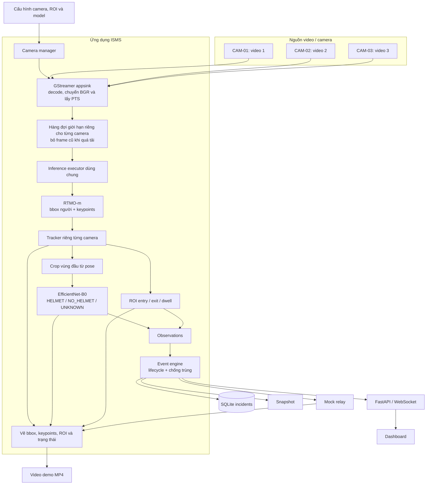

# Architecture

The reader process owns GStreamer objects and copies BGR frames to the application. A system Python process is used to accommodate PyGObject builds that do not match the uv environment's Python ABI. Inference is serialized through one shared executor. Tracking and rule state are independent per camera. Queues drop the oldest frame when full and report application queue drops. The pipeline propagates GStreamer PTS; missing PTS falls back to monotonic receive time, and a backwards PTS resets per-camera rule state.

`src/isms/config` validates configuration, `src/isms/app` manages camera tasks, `src/isms/media` handles ingestion, and `src/isms/inference` owns shared model execution. `src/isms/algorithms` composes camera-specific rules, while `src/isms/events` manages observations and incident lifecycles. The CLI and API share the same camera manager.

RTMO-m provides person boxes and COCO keypoints. The head crop is classified by EfficientNet-B0, subject to crop size, sharpness, confidence and consecutive-frame checks. ROI uses ankle keypoints when available, otherwise the bottom of the person box. A first observation inside is distinguished from an outside-to-inside crossing. Dwell uses PTS instead of frame count. The event engine deduplicates active violations, stores lifecycle changes and keeps the shared relay on while any intrusion remains active. It retains active events if a camera fails. The tracker is a baseline and may lose identity under occlusion.

Annotated MP4 files are diagnostic visualizations written at a configured fixed frame rate. They do not preserve source timing and should not be treated as evidence. No custom C code is required: GStreamer itself is native code accessed through its Python bindings.
