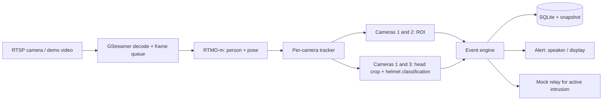
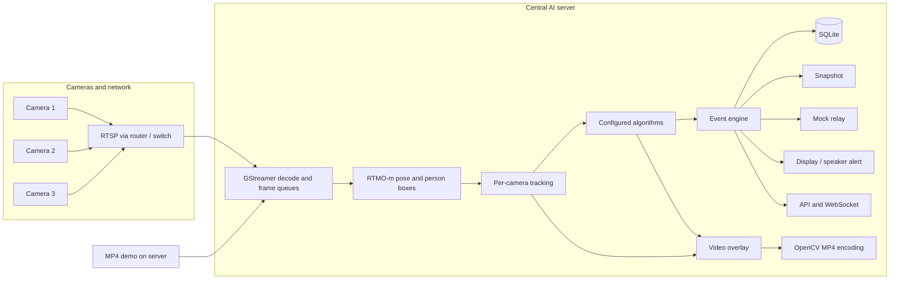
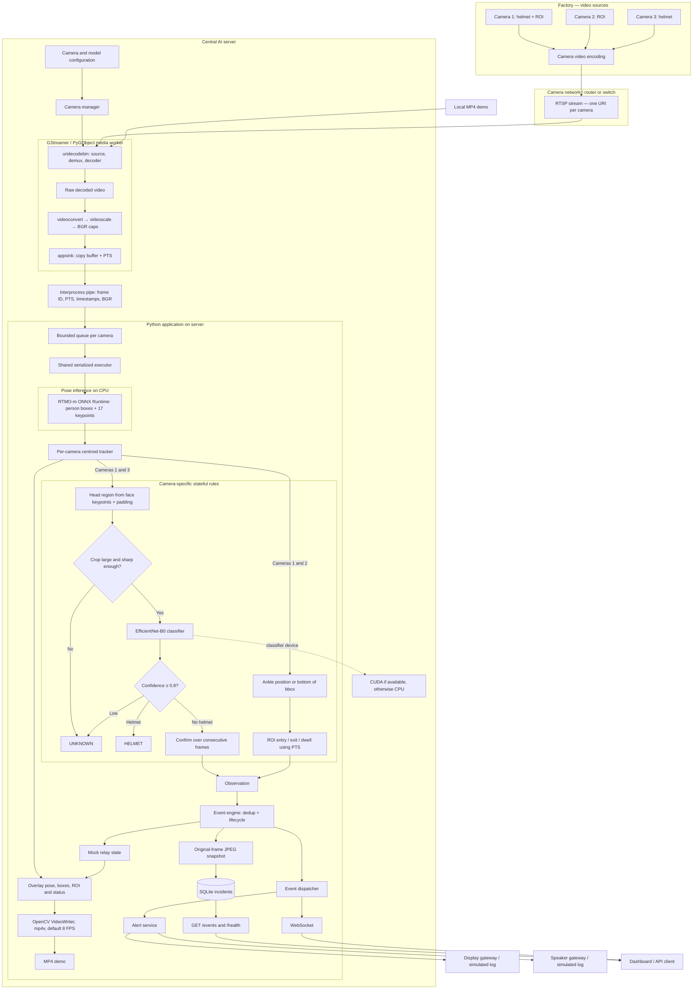

# Industrial Safety Monitoring — Problem Approach and System Design

## 1. Requirements analysis

The assignment calls for monitoring three cameras at different factory locations, retaining incidents, raising alerts, and simulating a hardware signal for restricted-area intrusion.

| Camera | Required analysis | Incident |
|---|---|---|
| Camera 1 | Detect entry into a dangerous area and check helmet use | Intrusion and no helmet |
| Camera 2 | Detect entry into a dangerous area | Intrusion |
| Camera 3 | Check helmet use | No helmet |

The system is divided into video ingestion, person detection and tracking, ROI and helmet rules, event processing, storage, alerts and simulated device control.

## 2. Assumed deployment conditions

| Component | Assumption |
|---|---|
| Architecture | One central server processes all three camera streams. |
| Camera placement | Cameras are fixed with suitable visibility and little occlusion. |
| Server | The target machine uses Ubuntu, an NVIDIA RTX 5060 GPU and GStreamer as the primary video ingestion library. |
| Network | Each camera supplies an RTSP URL on the local LAN. |
| Input | Each simulated camera supplies 4K video at 25 FPS. |
| Alerts | Events are sent to the alert service, which calls a speaker or display adapter. |
| Control | Intrusion activates a simulated relay. |

The GPU and RTSP environment are deployment assumptions. GPU identity was not verified because the OS blocked NVML access. 4K/25 FPS describes the assumed source, not a measured processing rate. The present demo uses MP4 files, including portrait 30 FPS footage, and resizes frames before inference.

## 3. Algorithm approach

1. **Video ingestion.** A camera provides RTSP over the LAN. GStreamer receives, decodes and converts frames to BGR before placing them in a camera-specific queue. MP4 files substitute for RTSP during the demo.
2. **Person and pose detection.** RTMO-m predicts person bounding boxes and body keypoints. A separate tracker assigns track IDs per camera.
3. **ROI check.** For cameras with an ROI rule, the person's foot position is compared with a fixed polygon. `ROI_ENTER` indicates a confirmed outside-to-inside transition. `ROI_OCCUPIED` indicates a person first observed inside.
4. **Helmet check.** For cameras with helmet checking enabled, face keypoints define a padded head crop. EfficientNet-B0 classifies it as `HELMET` or `NO_HELMET`. A missing, poor-quality or low-confidence crop is `UNKNOWN`.
5. **Event creation.** Rules send observations to the event engine. The engine deduplicates active incidents and persists incident history and snapshots.
6. **Camera-specific alerts.** Enabled camera rules determine the events produced. The alert service calls display/speaker adapters. An active intrusion turns on the mock relay.

On camera 1, helmet and ROI rules currently run independently. A person outside the ROI can therefore produce `NO_HELMET`. Camera 3 checks the whole frame because its assignment does not specify an ROI. Restricting camera 1's helmet check to people inside the ROI would require a pipeline change.

## 4. Camera rules and alerts

| Camera | Enabled rules | Outputs |
|---|---|---|
| Camera 1 | Helmet, ROI entry, ROI dwell | `NO_HELMET`, `ROI_ENTER`, `ROI_OCCUPIED`, `ROI_DWELL`; mock relay for active intrusion |
| Camera 2 | ROI entry | `ROI_ENTER`, `ROI_OCCUPIED`; mock relay for active intrusion |
| Camera 3 | Helmet | `NO_HELMET` |

Alert service filters by event type. Camera-specific behavior comes from enabled rules, not per-camera device routing. Default display and speaker adapters log simulated announcements. Configured endpoints receive HTTP POST requests; physical devices have not been verified.

## 5. System design

### Overview

### Detailed flow by deployment area

### Deployment boundaries

| Area | Responsibility |
|---|---|
| Camera | Produces an RTSP stream. Its codec and camera-side encoder depend on the device. |
| Router or switch | Carries video over the local network. |
| Server media worker | GStreamer `uridecodebin` selects source and decoder plugins, then converts, resizes and copies BGR frames with PTS. |
| Server application | Queues, tracking, rules, events, SQLite, API and output. RTMO-m currently uses CPU. |
| Classifier | PyTorch selects CUDA when available and CPU otherwise. |
| Output devices | Default adapters log simulated announcements. Configured gateways receive HTTP JSON. |

### Video ingestion and output

Each camera starts a GStreamer worker. `uridecodebin` chooses elements according to the URI and available plugins, followed by `videoconvert`, `videoscale`, BGR caps and appsink. The worker copies frame bytes and timing metadata through a pipe. The application queue drops older frames under load; appsink may also drop frames. The reported queue counter covers only the application queue.

After inference and event processing, the application draws an overlay on a frame copy. When recording is enabled, OpenCV `VideoWriter` encodes `mp4v` to MP4 at `record_fps`, default 8 FPS. The codec backend depends on OpenCV. Output does not preserve input PTS and can be shorter when frames are dropped. RTSP remains unverified in the recorded demo.

### From pose to a helmet incident

RTMO-m produces person boxes and keypoints, then the tracker assigns IDs. Sufficiently confident face points define a padded, image-bounded head crop. Missing, undersized, blurred or low-confidence crops become `UNKNOWN`. A `NO_HELMET` observation is raised after the configured consecutive-frame confirmation, default three frames. The engine deduplicates the incident per camera, rule and track, saves it and its snapshot, then publishes an update. A confirmed helmet observation resolves an active helmet incident.

### Snapshot and incident storage

For a new `NO_HELMET`, `ROI_ENTER`, `ROI_OCCUPIED` or `ROI_DWELL`, the engine creates a UUID and saves the original BGR frame as a JPEG in the configured snapshot directory. It inserts the incident into SQLite with camera, track, rule, type, UTC time, status, frame ID, PTS, confidence and snapshot path. Dwell incidents are immediately marked resolved. Exit and helmet resolution update the corresponding active incident. `CAMERA_OFFLINE` has no snapshot, and reaching the end of an MP4 currently produces that event.

### Alerts and mock relay

The dispatcher fans incident updates out to bounded subscriber queues. The alert service selects `ROI_ENTER`, `ROI_OCCUPIED`, `ROI_DWELL` and `NO_HELMET` and creates a Vietnamese announcement. Display and speaker adapters use `display_text` and `speak` actions. With an endpoint, the adapter sends HTTP JSON containing the event and announcement. Otherwise it logs the simulated action. Individual device failures are logged, with no retry; a full subscriber queue may drop older updates.

The mock relay is on while any `ROI_ENTER` or `ROI_OCCUPIED` incident remains active. A helmet incident alone does not turn it on. Camera failure retains active state, while track timeout can lead to an exit observation. The relay is a software state.

### API and dashboard

`GET /events` returns stored incidents, `GET /health` reports active camera tasks and mock relay state, and `/ws/events` streams incident changes. `GET /` serves the existing dashboard. CLI and API are separate entry points using the same manager implementation; starting both creates separate camera processing instances.

## 6. Current demo results

The three demo clips passed through GStreamer, RTMO, tracking and configured rules, producing events, snapshots and annotated videos. The run processed 15, 19 and 17 frames for the three cameras and dropped hundreds of frames under load. It does not establish 25 FPS per camera or event-level accuracy. See [training and evaluation](04_training_and_evaluation.md) for the recorded metrics.
