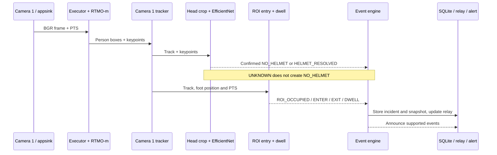
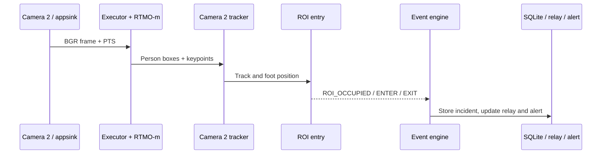
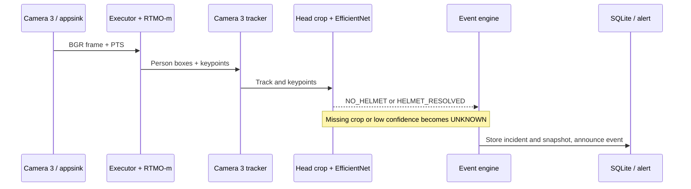
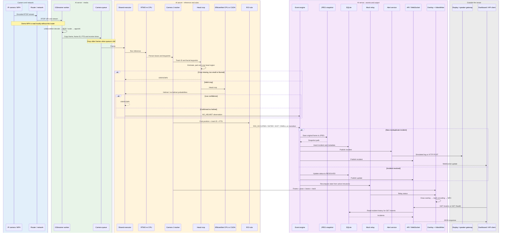

# Camera Algorithm Sequences

Camera tasks may run concurrently through one shared inference executor. Each camera has its own tracker and rule state.

## Camera 1 — helmet and ROI

## Camera 2 — ROI

## Camera 3 — helmet

Camera 2 has no dwell rule enabled. Camera 3 has no ROI rule. Rules are set in `configs/cameras.yaml`.

## Complete sequence from RTSP to devices

This example uses camera 1. Camera 2 omits helmet classification and camera 3 omits ROI. Boxes indicate deployment areas. RTSP and HTTP gateways require configuration and verification in the target environment.

