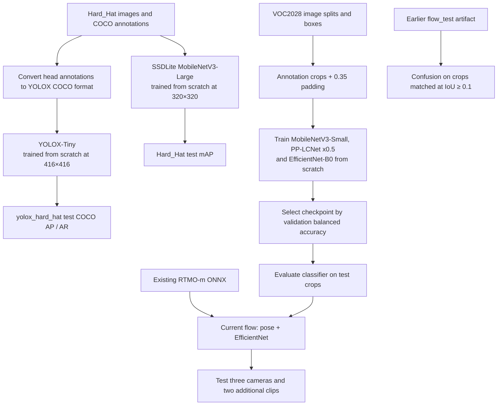
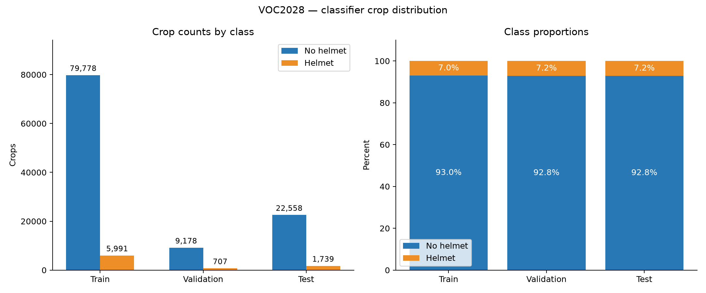
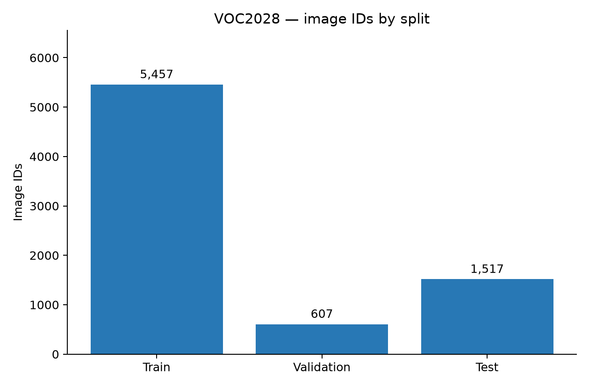
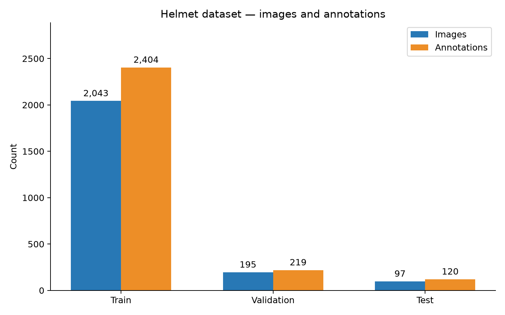
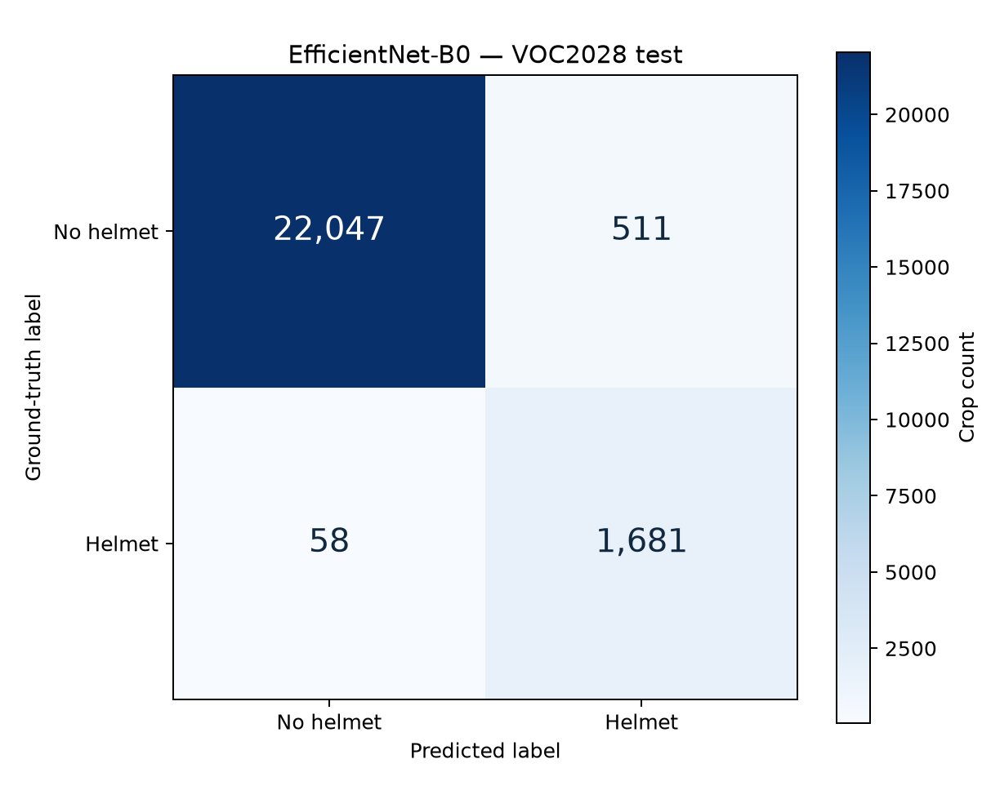
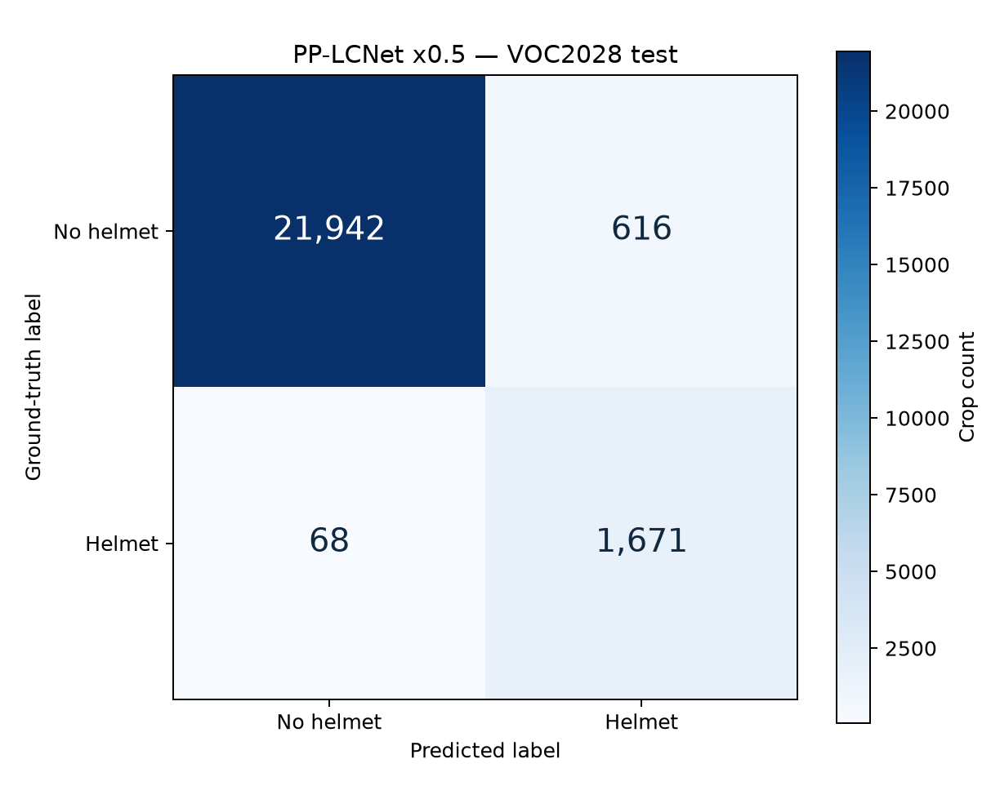
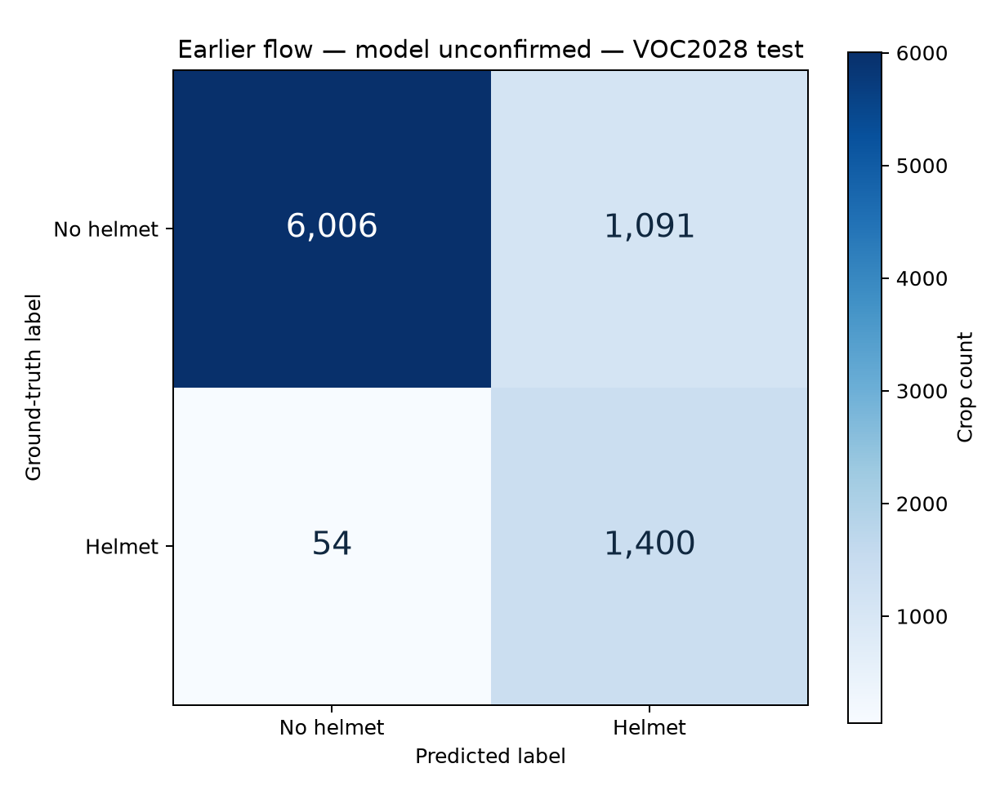

# Training, Testing and Model Selection

## Experiment flow

YOLOX annotations were converted from Hard_Hat, retaining the source splits and selecting the `head` class. `val_log.txt` was produced by the evaluator configured for the test split. See `training/README_yolox.md` and `training/yolox_hard_hat_test.py`.

Classifier crops use VOC2028 train/validation/test image IDs, annotation boxes, 128×128 resizing and weighted sampling. The training script initializes the classifiers without pretrained weights. The earlier `flow_test` artifact lacks backend and checkpoint metadata, so it cannot be attributed to a specific model. Demo videos have no event ground truth and are qualitative tests.

## Model selection rationale — to be completed

### Why RTMO-m for pose?

> **Reason:** ........................................................................  
> **Comparison and evidence:** .......................................................  
> **Accuracy, speed and hardware trade-offs:** .......................................

### Why EfficientNet-B0 for classification?

> **Reason:** ........................................................................  
> **Metrics or experiments used for comparison:** ....................................  
> **Trade-offs and limitations on pose-derived crops:** ..............................

### Why a centroid tracker and GStreamer?

> **Reason:** ........................................................................  
> **Limitations and alternatives:** ..................................................

# Evaluation by Model and Dataset

## Scope

Classifier values are calculated from `models/*/metrics.json`. Confusion matrix rows are **ground-truth labels** and columns are **predicted labels**. Precision, recall and F1 are calculated per class. All three classifiers were evaluated on the same 24,297 VOC2028 test crops derived from annotation boxes. These results exclude pose, tracker and ROI errors, as well as the runtime `UNKNOWN` threshold and debounce.

The training script maps source labels `person` to `no_helmet` and `hat` to `helmet`. Their meaning should be checked against the source dataset documentation. Image IDs do not overlap between splits, but duplicate image content has not been ruled out.

| VOC2028 crop split | No helmet | Helmet | Total |
|---|---:|---:|---:|
| Train | 79,778 | 5,991 | 85,769 |
| Validation | 9,178 | 707 | 9,885 |
| Test | 22,558 | 1,739 | 24,297 |

### VOC2028 dataset distribution

The helmet class accounts for around 7% of crops in each split before weighted sampling. Counts come from `data/voc_helmet_crops/{train,val,test}/manifest.csv`.

There are 5,457 train, 607 validation and 1,517 test image IDs, counted from `data/VOC2028/ImageSets/Main/{train,val,test}.txt`. One image may yield multiple crops.

### Helmet dataset

| Split | Images | Annotations |
|---|---:|---:|
| Train | 2,043 | 2,404 |
| Validation | 195 | 219 |
| Test | 97 | 120 |

Counts come from the `_annotations.coco.json` files under `data/helmet`. Two category IDs have the same `helmet` name; the chart counts all annotations. This describes available data and is not the VOC crop source used for the three classifiers. `Hard_Hat` and `yolox_hard_hat` data folders are currently absent, so their distributions cannot be plotted from original annotations.

## EfficientNet-B0 — VOC2028 test crops

| Class | Precision | Recall | F1 | Support |
|---|---:|---:|---:|---:|
| No helmet | 99.74% | 97.73% | 98.73% | 22,558 |
| Helmet | 76.69% | 96.66% | 85.53% | 1,739 |

Validation balanced accuracy was 96.71%; the selected checkpoint was epoch 11. Of 22,558 no-helmet crops, 511 were predicted as helmet. Source: `models/helmet_classifier_efficientnet/metrics.json`. This is the configured classifier in the current flow.

## MobileNetV3-Small — VOC2028 test crops

| Class | Precision | Recall | F1 | Support |
|---|---:|---:|---:|---:|
| No helmet | 99.79% | 97.32% | 98.54% | 22,558 |
| Helmet | 73.66% | 97.30% | 83.85% | 1,739 |

Validation balanced accuracy was 96.95%; checkpoint epoch 7. Source: `models/helmet_classifier/metrics.json`.

## PP-LCNet x0.5 — VOC2028 test crops

| Class | Precision | Recall | F1 | Support |
|---|---:|---:|---:|---:|
| No helmet | 99.69% | 97.27% | 98.47% | 22,558 |
| Helmet | 73.07% | 96.09% | 83.01% | 1,739 |

Validation balanced accuracy was 96.65%; checkpoint epoch 12. Source: `models/helmet_classifier_pplcnet/metrics.json`. The classifier matrices use argmax; the runtime also applies a 0.8 confidence threshold and `UNKNOWN`.

## Earlier flow — VOC2028 test, model unconfirmed

`models/helmet_classifier/flow_test/metrics.json` records 1,517 images, 24,297 ground-truth boxes, 9,260 head crops and 8,551 matched pairs at IoU ≥ 0.1. The matrix includes **matched pairs only**. It excludes 15,746 unmatched ground-truth boxes and 709 unmatched predictions. Backend and checkpoint metadata are absent, so the result cannot be attributed to RTMO-m or a specific classifier.

## SSDLite MobileNetV3-Large — Hard_Hat

| Split | COCO mAP |
|---|---:|
| Validation | 0.3651 |
| Test | 0.3703 |

Source: `models/hard_hat/metrics.json`, `head` class. The model was trained from scratch at 320×320. The available artifact contains neither a confusion matrix nor per-image predictions needed to reconstruct one.

## YOLOX-Tiny — yolox_hard_hat

| Test metric | Result |
|---|---:|
| AP IoU 0.50:0.95 | 0.603 |
| AP IoU 0.50 | 0.939 |
| AP IoU 0.75 | 0.696 |
| AR IoU 0.50:0.95, maxDets 100 | 0.665 |

Source: `models/yolox_hard_hat/val_log.txt`. The test evaluator is configured in `training/yolox_hard_hat_test.py`. This single-class `head` detector uses 416×416 input. Its log lacks a confusion matrix and the predictions required to reconstruct one at specified IoU and confidence thresholds. SSDLite and YOLOX use different input sizes and training configurations.

## Current RTMO-m + EfficientNet flow

No evaluation artifact with sufficient metadata was found for the current combination on VOC2028 or camera test footage. The unlabeled videos cannot provide event precision, recall, F1 or a confusion matrix. A reproducible evaluation needs the checkpoint, backend, split, thresholds, predictions and ground truth.

The three-camera demo processed 15, 19 and 17 frames and dropped 309, 408 and 462 frames in the application queues. Two additional clips processed 39 and 68 frames and dropped 921 and 1,043. See [problem approach and system design](00_problem_approach.md) for deployment context.

## Datasets without evaluation results

`data/helmet` and the input videos have no complete evaluation artifact for the current model. Their event accuracy and confusion matrices cannot be inferred from alert logs.
