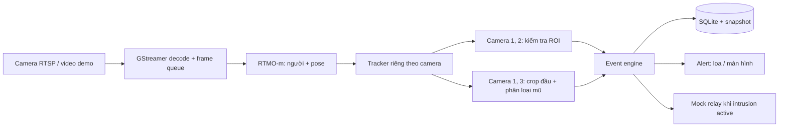
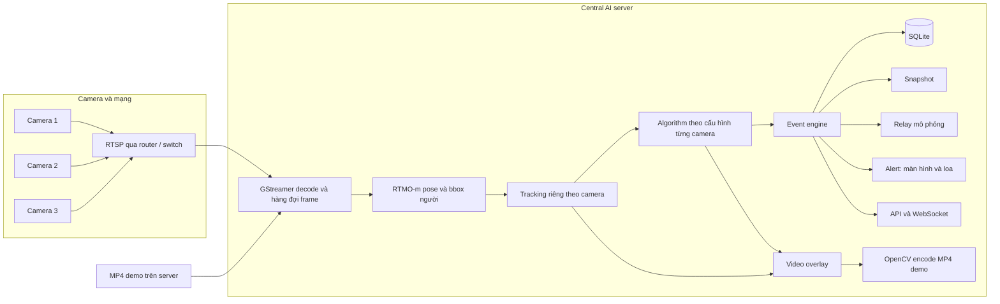
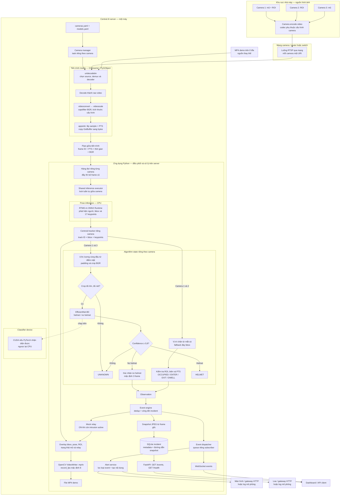

# Cách tiếp cận bài toán giám sát an toàn

## Bước 1. Phân tích đề bài

Bài toán yêu cầu giám sát ba camera tại ba khu vực khác nhau và xử lý theo rule của từng camera.

| Camera | Phân tích hình ảnh | Sự kiện cần xử lý |
|---|---|---|
| Camera 1 | Phát hiện người vào khu vực nguy hiểm và kiểm tra người có đội mũ bảo hộ | Xâm nhập ROI; không đội mũ |
| Camera 2 | Phát hiện người vào khu vực nguy hiểm | Xâm nhập ROI |
| Camera 3 | Kiểm tra người có đội mũ bảo hộ | Không đội mũ |

Khi phát hiện vi phạm, hệ thống cần lưu lịch sử và phát cảnh báo. Với xâm nhập ROI, hệ thống cần giả lập tín hiệu điều khiển thiết bị như relay, còi hoặc đèn. Đề bài cho phép tự chọn công nghệ, model và dữ liệu, đồng thời không yêu cầu hoàn thành toàn bộ chức năng.

Để triển khai, bài toán được chia thành các phần: thu nhận video; phát hiện và theo dõi người; kiểm tra ROI và mũ; tạo event; lưu trữ; cảnh báo và mô phỏng thiết bị.

## Bước 2. Giả lập điều kiện triển khai

Các điều kiện dưới đây được đặt ra cho phương án thiết kế vì đề bài chưa cung cấp chi tiết môi trường.

| Thành phần | Giả định |
|---|---|
| Kiến trúc | Một server trung tâm nhận và xử lý đồng thời ba luồng camera. |
| Camera và vị trí lắp đặt | Camera được lắp cố định ở vị trí phù hợp, tầm nhìn đủ tốt và người ít bị che khuất. |
| Server | Máy hiện tại được giả định dùng Ubuntu, GPU NVIDIA RTX 5060 và GStreamer là thư viện chính để thu nhận video. |
| Mạng | Mỗi camera cung cấp một URL RTSP và kết nối với server qua mạng LAN local. |
| Đầu vào video | Giả lập mỗi camera phát video 4K, 25 FPS. |
| Cảnh báo | Event được đưa tới alert service, sau đó gọi module loa cảnh báo hoặc thiết bị hiển thị theo cấu hình. |
| Thiết bị điều khiển | Khi xâm nhập vùng nguy hiểm, relay được mô phỏng bằng trạng thái phần mềm. |

GPU RTX 5060 và khả năng vận hành các luồng RTSP là giả định cho phương án; thông tin GPU không được xác minh trong phiên kiểm tra vì hệ điều hành chặn truy cập NVML. Mức 4K/25 FPS là đầu vào giả lập, không phải cam kết FPS xử lý của hệ thống. Với demo hiện tại, nguồn trong cấu hình là MP4 và có clip dọc 30 FPS; frame được resize về kích thước cấu hình trước khi inference.

## Bước 3. Cách tiếp cận thuật toán

1. **Nhận luồng:** camera đưa video qua RTSP/LAN đến server. GStreamer đọc, decode, chuyển frame sang BGR và đưa vào hàng đợi theo từng camera. Trong demo, MP4 thay thế nguồn RTSP.
2. **Phát hiện người và pose:** RTMO-m tìm bbox người và các keypoints cơ thể. Mỗi camera có tracker riêng để gắn track ID cho từng người.
3. **Kiểm tra ROI:** với camera có rule ROI, dùng vị trí chân của từng người để kiểm tra người ở ngoài hay trong polygon cố định. Phát `ROI_ENTER` khi xác nhận đi từ ngoài vào trong; `ROI_OCCUPIED` khi người đã ở trong vùng tại lần quan sát đầu.
4. **Kiểm tra mũ:** với camera có rule mũ, dùng keypoints vùng mặt để ước lượng vùng đầu, mở rộng vùng crop rồi đưa ảnh vào EfficientNet-B0. Model phân loại `HELMET` hoặc `NO_HELMET`; ảnh đầu không đủ rõ hoặc confidence thấp nhận `UNKNOWN`.
5. **Tạo event:** rule chuyển observation tới event engine. Engine chống tạo lại event active trùng, lưu lịch sử SQLite và snapshot khi tạo incident.
6. **Cảnh báo theo camera:** các rule đã bật quyết định event nào được tạo cho từng camera. Alert service nhận event, gọi adapter màn hình/loa; intrusion active kích hoạt mock relay.

### Phạm vi ROI và kiểm tra mũ

Phương án xem xét người trong vùng ROI và kiểm tra mũ từ pose. Cấu hình hiện tại chạy **hai rule độc lập trên camera 1**: kiểm tra mũ cho người được phát hiện trong khung hình và kiểm tra ROI theo vị trí chân. Do đó `NO_HELMET` hiện có thể được tạo cả khi người ở ngoài ROI. Camera 3 kiểm tra mũ trong toàn khung hình vì đề bài không yêu cầu ROI cho camera này. Nếu chỉ muốn camera 1 kiểm tra mũ sau khi người vào ROI, cần thay đổi điều kiện của pipeline.

## Bước 4. Cấu hình cảnh báo theo camera

| Camera | Rule đang bật | Cảnh báo / output |
|---|---|---|
| Camera 1 | `helmet_compliance`, `roi_entry`, `roi_dwell` | `NO_HELMET`, `ROI_ENTER`, `ROI_OCCUPIED`, `ROI_DWELL`; relay mô phỏng khi có intrusion active |
| Camera 2 | `roi_entry` | `ROI_ENTER`, `ROI_OCCUPIED`; relay mô phỏng khi có intrusion active |
| Camera 3 | `helmet_compliance` | `NO_HELMET`; không có rule ROI trong cấu hình mẫu |

Alert service hiện lọc theo **loại event**. Việc camera nào phát event được quyết định bởi rule bật trong `configs/cameras.yaml`; chưa có cấu hình định tuyến loa hoặc màn hình riêng cho từng camera. Cấu hình mẫu dùng adapter loa và màn hình mô phỏng bằng log. Khi khai báo endpoint, adapter gửi HTTP POST tới gateway tương thích; chưa xác nhận giao tiếp với thiết bị thật.

## Bước 5. Thiết kế hệ thống

### Sơ đồ tổng quan hệ thống

Camera 1 chạy kiểm tra mũ và ROI, camera 2 chạy ROI, camera 3 chạy kiểm tra mũ. Ba nguồn MP4 cấu hình trong `configs/cameras.yaml` mô phỏng CCTV. Alert mặc định ghi log mô phỏng, hoặc gửi HTTP POST nếu cấu hình endpoint. Video overlay do CLI tạo khi bật `record_demo`.

### Flow chi tiết theo khu vực triển khai

Sơ đồ mô tả luồng đang được triển khai và cách kết nối RTSP dự kiến. Trong demo hiện tại, ba camera được mô phỏng bằng MP4. Camera IP, router, RTSP và gateway thiết bị là các thành phần bên ngoài cần có trong môi trường thực tế.

### Diễn giải vị trí thực thi

| Vùng | Thành phần | Vai trò trong project |
|---|---|---|
| Camera | Camera IP | Tạo stream RTSP theo cấu hình thiết bị. Codec và thao tác encode phía camera phụ thuộc phần cứng, không do project điều khiển. |
| Mạng | Router hoặc switch | Chuyển stream tới server. Sơ đồ không giả định router thực hiện inference. |
| Server: media | Tiến trình Python hệ thống + PyGObject | `uridecodebin` tự chọn phần tử source/decode theo URI và plugin. Sau đó chuyển BGR, scale, lấy sample và PTS qua appsink. |
| Server: ứng dụng | Python, OpenCV, ONNX Runtime, SQLite | Hàng đợi, tracking, rule, event, storage, API và output chạy trên server. RTMO-m cấu hình mặc định dùng CPU. |
| Server: classifier | PyTorch | EfficientNet tự chọn CUDA nếu khả dụng, nếu không dùng CPU. |
| Thiết bị đầu ra | Gateway, màn hình, loa | Cấu hình mặc định ghi log mô phỏng. Nếu có endpoint, ứng dụng gửi HTTP JSON tới gateway tương thích. |

### Luồng nhận và xuất video

1. Camera thực gửi URI RTSP qua mạng. Với demo, `source` là đường dẫn MP4 và được chuyển thành `file://` URI. RTSP là khả năng cấu hình, chưa được kiểm thử trong lượt demo.
2. Mỗi camera có một worker GStreamer. `uridecodebin` xây dựng các phần tử source và decode dựa trên stream và plugin có sẵn. Code không cố định camera dùng H.264 hoặc một decoder phần cứng cụ thể.
3. Raw frame đi qua `videoconvert`, `videoscale`, `capsfilter` và appsink. Worker copy BGR, PTS, frame ID và thời gian nhận qua pipe tới ứng dụng.
4. Hàng đợi bounded ưu tiên frame mới. Appsink cũng có chế độ drop. Số liệu `queue_dropped` trong log chỉ đếm frame bị bỏ tại hàng đợi ứng dụng.
5. Sau rule và event, ứng dụng vẽ overlay trên bản sao frame. Khi bật recording, OpenCV `VideoWriter` encode với FourCC `mp4v` thành MP4; backend codec cụ thể phụ thuộc môi trường OpenCV. Output mặc định 8 FPS, không giữ nguyên PTS và có thể ngắn hơn video nguồn khi frame bị bỏ.

### Từ pose đến event mũ bảo hộ

1. RTMO-m nhận frame và trả bbox người cùng keypoints. Mỗi người được tracker gắn track ID riêng trong camera đó.
2. Các điểm vùng mặt đủ confidence dùng để ước lượng vùng đầu. Crop được mở rộng lên phía trên và giới hạn theo biên ảnh.
3. Crop không tồn tại, quá nhỏ hoặc quá mờ được gán `UNKNOWN`. Crop hợp lệ được EfficientNet-B0 phân loại `helmet` / `no_helmet`; confidence thấp hơn ngưỡng cũng trở thành `UNKNOWN`.
4. Khi `no_helmet` đạt ngưỡng trong số frame liên tiếp theo cấu hình, mặc định 3 frame, thuật toán gửi observation `NO_HELMET` cùng track ID và PTS tới event engine.
5. Event engine kiểm tra event active trùng theo camera, rule và track. Với event mới, engine lưu snapshot và incident, rồi phát cập nhật. Nếu track được xác nhận đội mũ trở lại, event đang active được cập nhật `RESOLVED`.

### Event, snapshot, alert, relay và API

#### Snapshot và lưu lịch sử

- Khi tạo `NO_HELMET`, `ROI_ENTER`, `ROI_OCCUPIED` hoặc `ROI_DWELL`, engine tạo UUID và lưu bản **frame BGR gốc** thành `snapshots/<event_id>.jpg`, theo `storage.snapshot_dir`. Snapshot không phải frame đã vẽ overlay.
- Incident được insert vào bảng `incidents` của SQLite với camera, track, rule, loại event, thời gian UTC, trạng thái, `frame_id`, PTS, confidence và đường dẫn snapshot. `ROI_DWELL` được lưu `RESOLVED` ngay khi phát; các event còn lại có lifecycle active/resolved.
- Khi `ROI_EXIT` hoặc `HELMET_RESOLVED`, engine cập nhật incident tương ứng. `CAMERA_OFFLINE` được lưu không có snapshot. Với MP4, kết thúc file hiện cũng tạo event này.

#### Alert và thiết bị

- Dispatcher gửi bản sao event tới queue của mỗi subscriber. Alert service lọc `ROI_ENTER`, `ROI_OCCUPIED`, `ROI_DWELL` và `NO_HELMET`, sau đó tạo nội dung tiếng Anh theo camera. Cấu hình `alert_language: vi` để dùng tiếng Việt.
- Adapter `display` dùng action `display_text`, adapter `speaker` dùng `speak`. Nếu cấu hình `endpoint`, adapter gửi HTTP POST JSON gồm event ID, camera, track, loại event, severity, nội dung và action. Nếu không có endpoint, adapter ghi log mô phỏng.
- Lỗi một thiết bị được ghi log và không chặn thiết bị khác. Chưa có cơ chế retry; subscriber queue có giới hạn và có thể bỏ cập nhật cũ khi quá tải.

#### Relay mô phỏng

- Relay được bật khi cấu hình cho phép và còn ít nhất một intrusion `ROI_ENTER` hoặc `ROI_OCCUPIED` active trên bất kỳ camera nào. `NO_HELMET` đơn lẻ không bật relay.
- Một người ra khỏi vùng không tắt relay nếu vẫn còn intrusion active khác. Khi nguồn camera lỗi, engine giữ event active và trạng thái relay. Khi track timeout, rule hiện có thể phát exit, vì vậy kết quả phụ thuộc chất lượng tracking.
- Đây là trạng thái phần mềm `MockRelay`; sơ đồ không biểu thị kết nối dây hoặc lệnh tới relay vật lý.

#### API và dashboard

- `GET /events` đọc lịch sử incident từ SQLite. `GET /health` trả số camera task đang chạy và trạng thái mock relay.
- `/ws/events` gửi event mới hoặc thay đổi trạng thái thông qua subscriber queue. `GET /` trả trang dashboard hiện có.
- API và CLI cùng dùng camera manager nhưng là hai cách khởi động riêng. Chạy cả hai tạo hai bộ xử lý camera riêng.

## Bước 6. Đối chiếu với kết quả chạy hiện tại

Ba clip demo đã đi qua luồng GStreamer, RTMO, tracking và rule theo cấu hình. Hệ thống có tạo event, snapshot và video overlay. Trong lần chạy trước, số frame xử lý cho ba camera lần lượt là 15, 19 và 17; hàng trăm frame bị bỏ khi quá tải. Vì vậy chưa thể kết luận hệ thống đạt 25 FPS cho mỗi camera hoặc đánh giá đầy đủ độ chính xác sự kiện.

Quy trình train/test và confusion matrix nằm trong [tài liệu đánh giá](04_training_and_evaluation.md).
