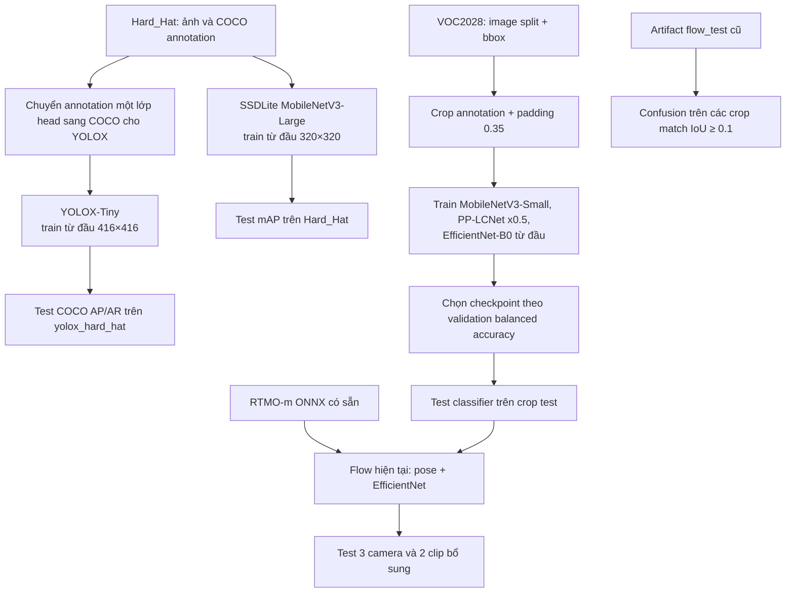
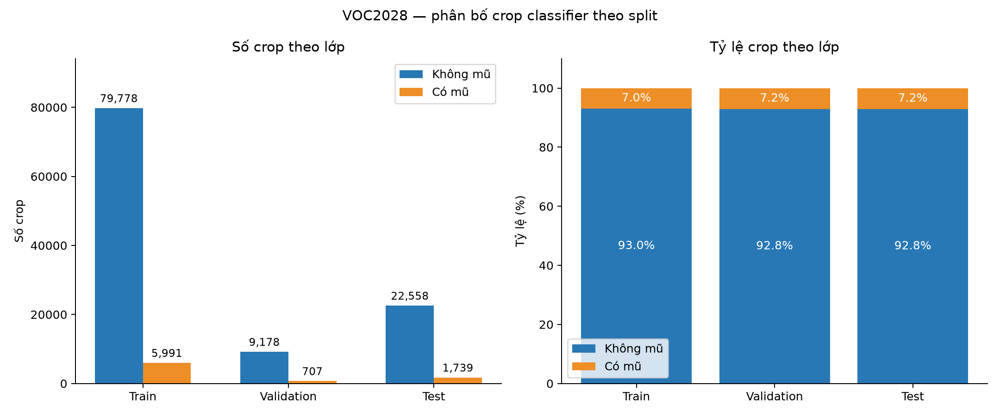
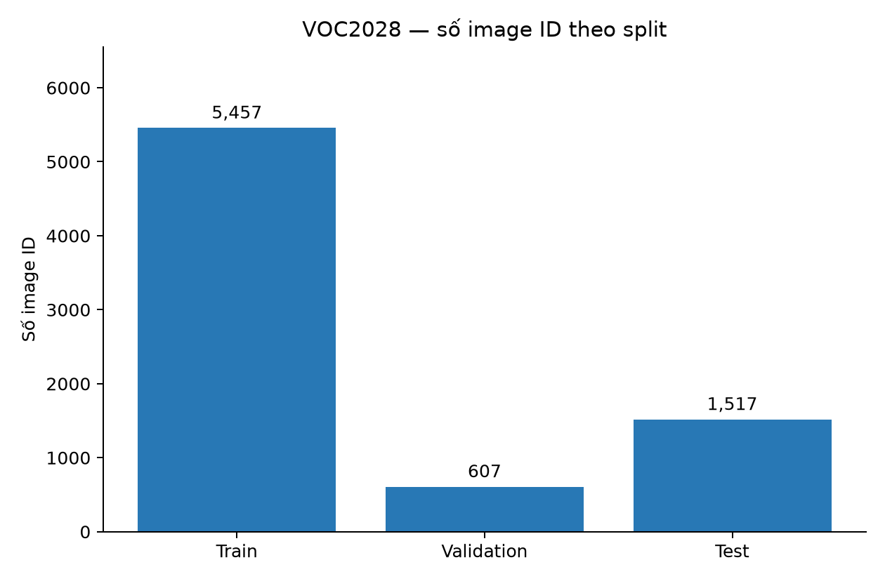
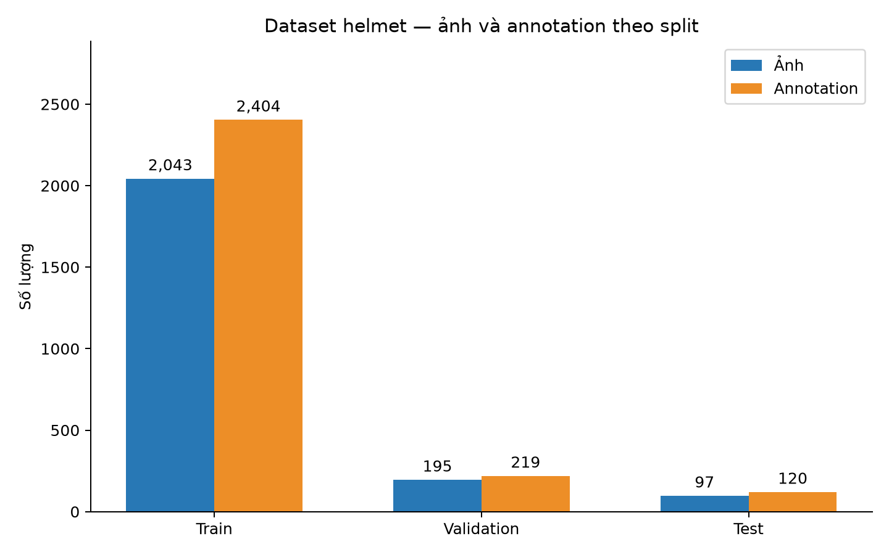
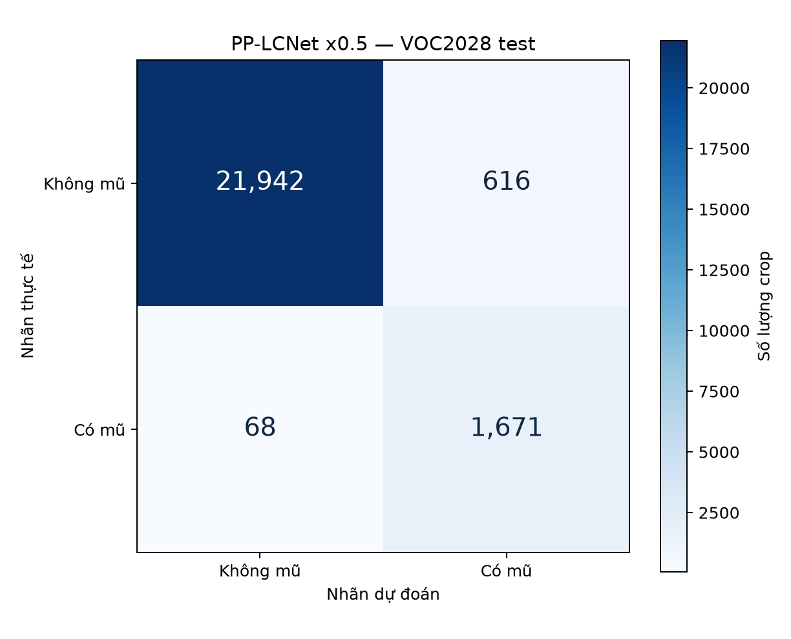
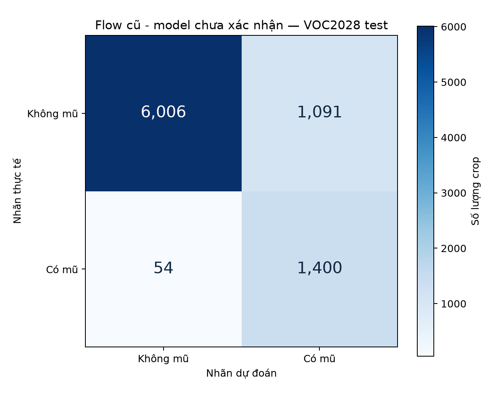

# Train, test và lý do chọn model

## Các nhánh thử nghiệm

- YOLOX dữ liệu `data/yolox_hard_hat` được chuyển từ Hard_Hat, giữ split nguồn và chọn lớp `head`. Log `val_log.txt` được tạo từ evaluator cấu hình tập test. Chi tiết xem `training/README_yolox.md` và `training/yolox_hard_hat_test.py`.
- Các classifier dùng train/val/test theo image ID của VOC2028, crop annotation, resize 128×128 và weighted sampling. Script train khởi tạo không dùng pretrained weights.
- Artifact `models/helmet_classifier/flow_test/metrics.json` thiếu metadata checkpoint/backend. Tên folder không đủ để xác định model, và matrix chỉ tính trên dự đoán khớp nhãn. Cần chạy lại với cấu hình ghi nhận rõ để so sánh với flow hiện tại.
- Video demo đánh giá định tính, chưa có nhãn để tính metric sự kiện. Số liệu có trong phần đánh giá bên dưới.

# Kết quả đánh giá theo model và dữ liệu

## Phạm vi và cách đọc

Số liệu classifier lấy từ `models/*/metrics.json`. Hàng confusion matrix là **nhãn thực tế**, cột là **nhãn dự đoán**. Precision, recall và F1 được tính riêng cho từng lớp từ matrix. Ba model classifier được đánh giá trên crop từ annotation VOC2028 test, cùng 24.297 crop. Kết quả chưa bao gồm lỗi pose, tracking, ROI, ngưỡng `UNKNOWN` hay debounce của flow runtime.

Nguồn dữ liệu sử dụng trong script quy đổi `person` thành `no_helmet` và `hat` thành `helmet`. Ý nghĩa nhãn cần được xác minh với tài liệu dataset gốc. Các split được kiểm tra không trùng image ID, chưa chứng minh không có ảnh trùng nội dung giữa các split.

| Split VOC2028 crop | Không mũ | Có mũ | Tổng |
|---|---:|---:|---:|
| Train | 79.778 | 5.991 | 85.769 |
| Validation | 9.178 | 707 | 9.885 |
| Test | 22.558 | 1.739 | 24.297 |

### Phân bố dữ liệu VOC2028

Dữ liệu crop bị mất cân bằng. Lớp `helmet` chiếm khoảng 7% trong mỗi split trước khi áp dụng weighted sampling. Nguồn biểu đồ là `data/voc_helmet_crops/{train,val,test}/manifest.csv`.

Split gồm 5.457 image ID train, 607 validation và 1.517 test, được đếm từ `data/VOC2028/ImageSets/Main/{train,val,test}.txt`. Một ảnh có thể tạo nhiều crop nên số ảnh và số crop khác nhau.

### Dataset helmet

| Split | Ảnh | Annotation |
|---|---:|---:|
| Train | 2.043 | 2.404 |
| Validation | 195 | 219 |
| Test | 97 | 120 |

Số liệu lấy từ các file `_annotations.coco.json` trong `data/helmet`. Hai category ID trong annotation cùng mang tên `helmet`; biểu đồ đếm tổng annotation. Bộ này được trình bày để mô tả dữ liệu hiện có, không phải nguồn crop VOC dùng để huấn luyện ba classifier ở phần trên. Chưa có biểu đồ phân bố Hard_Hat và yolox_hard_hat từ annotation gốc.

## EfficientNet-B0 — VOC2028 crop test

| Lớp | Precision | Recall | F1 | Support |
|---|---:|---:|---:|---:|
| Không mũ | 99,74% | 97,73% | 98,73% | 22.558 |
| Có mũ | 76,69% | 96,66% | 85,53% | 1.739 |

Validation balanced accuracy 96,71%, checkpoint epoch 11. Trong 22.558 crop không mũ, 511 crop được dự đoán là có mũ.

Nguồn `models/helmet_classifier_efficientnet/metrics.json`. Model này được cấu hình trong flow hiện tại.

## MobileNetV3-Small — VOC2028 crop test

| Lớp | Precision | Recall | F1 | Support |
|---|---:|---:|---:|---:|
| Không mũ | 99,79% | 97,32% | 98,54% | 22.558 |
| Có mũ | 73,66% | 97,30% | 83,85% | 1.739 |

Validation balanced accuracy 96,95%, checkpoint epoch 7.

Nguồn `models/helmet_classifier/metrics.json`.

## PP-LCNet x0.5 — VOC2028 crop test

| Lớp | Precision | Recall | F1 | Support |
|---|---:|---:|---:|---:|
| Không mũ | 99,69% | 97,27% | 98,47% | 22.558 |
| Có mũ | 73,07% | 96,09% | 83,01% | 1.739 |

Validation balanced accuracy 96,65%, checkpoint epoch 12.

Nguồn `models/helmet_classifier_pplcnet/metrics.json`. Các matrix classifier dùng dự đoán argmax; runtime hiện dùng thêm ngưỡng confidence 0,8 và `UNKNOWN`.

## Flow cũ — VOC2028 test, model chưa xác nhận

Artifact `models/helmet_classifier/flow_test/metrics.json` ghi 1.517 ảnh, 24.297 ground-truth box, 9.260 head crop và 8.551 cặp khớp tại IoU ≥ 0,1. Confusion matrix dưới đây **chỉ tính các cặp đã khớp**. Còn 15.746 ground-truth box và 709 dự đoán không khớp, không xuất hiện trong matrix. Artifact thiếu metadata về backend và checkpoint, nên chưa thể quy kết kết quả cho RTMO-m hay một classifier cụ thể.

## SSDLite MobileNetV3-Large — Hard_Hat

| Split | COCO mAP |
|---|---:|
| Validation | 0,3651 |
| Test | 0,3703 |

Nguồn `models/hard_hat/metrics.json`, lớp `head`. Model được train từ đầu với input 320×320. Artifact hiện có không chứa confusion matrix hoặc dự đoán theo từng ảnh để dựng matrix có căn cứ.

## YOLOX-Tiny — yolox_hard_hat

| Metric trên test | Kết quả |
|---|---:|
| AP IoU 0,50:0,95 | 0,603 |
| AP IoU 0,50 | 0,939 |
| AP IoU 0,75 | 0,696 |
| AR IoU 0,50:0,95, maxDets 100 | 0,665 |

Nguồn `models/yolox_hard_hat/val_log.txt`; evaluator test được cấu hình tại `training/yolox_hard_hat_test.py`. Đây là model detection một lớp `head`, input 416×416. Log không chứa confusion matrix hoặc dữ liệu dự đoán cần thiết để tái tạo matrix theo ngưỡng IoU/confidence đã định. Các kết quả SSDLite và YOLOX dùng cấu hình train và input khác nhau, cần cân nhắc khi so sánh.

## RTMO-m + EfficientNet — flow hiện tại

RTMO-m ONNX được dùng để lấy bbox/keypoints và crop đầu, EfficientNet-B0 phân loại crop. Chưa tìm thấy artifact đánh giá có đủ metadata cho tổ hợp hiện tại trên VOC2028 hoặc bộ test camera. Không thể tính precision, recall, F1 và confusion matrix của flow này từ các video chưa gán nhãn. Cần lưu thêm checkpoint, backend, split, ngưỡng, dự đoán và nhãn để tái lập đánh giá.

Lần chạy ba camera demo chỉ xử lý 15, 19 và 17 frame, tương ứng 309, 408 và 462 frame bị bỏ ở hàng đợi ứng dụng. Hai video bổ sung xử lý 39 và 68 frame, bỏ 921 và 1.043 frame. Xem [cách tiếp cận và thiết kế hệ thống](00_problem_approach.md) để biết thêm về giới hạn của lượt chạy.

## Những bộ dữ liệu chưa có kết quả

Tập `data/helmet` và các video đầu vào hiện chưa có artifact đánh giá đầy đủ cho model hiện tại. Không có confusion matrix đáng tin cậy cho các bộ này trong các kết quả đã tìm thấy. Số liệu và biểu đồ cần được tạo từ phép đánh giá có ground truth, không suy ra từ log cảnh báo.
